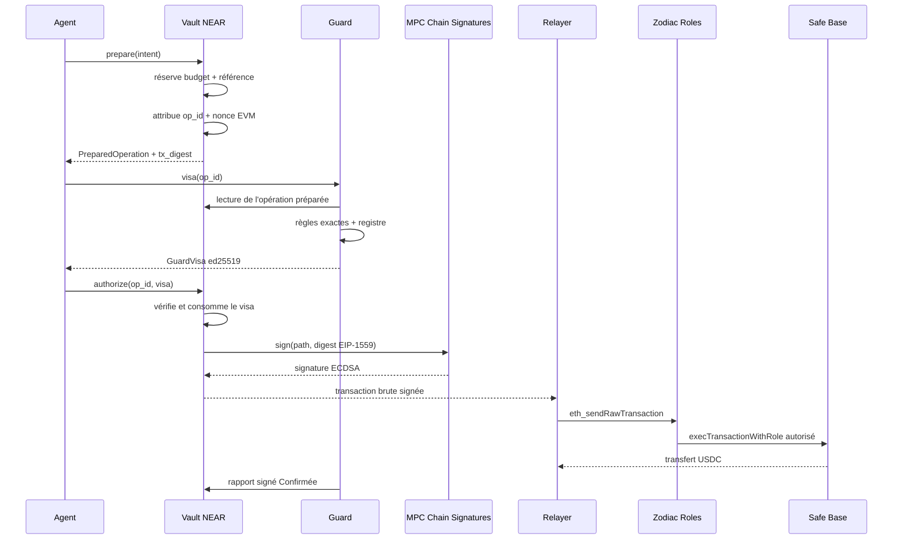
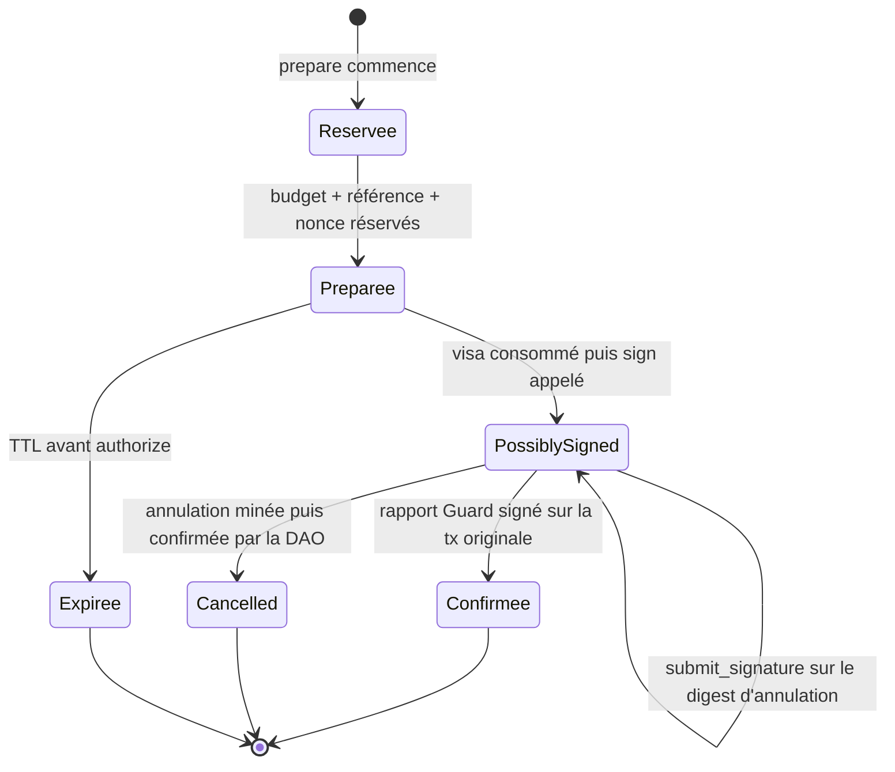
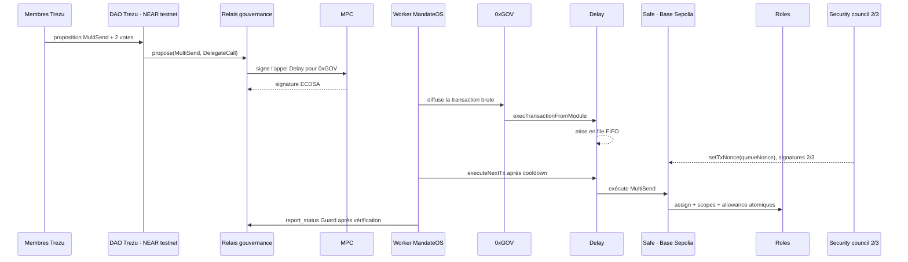
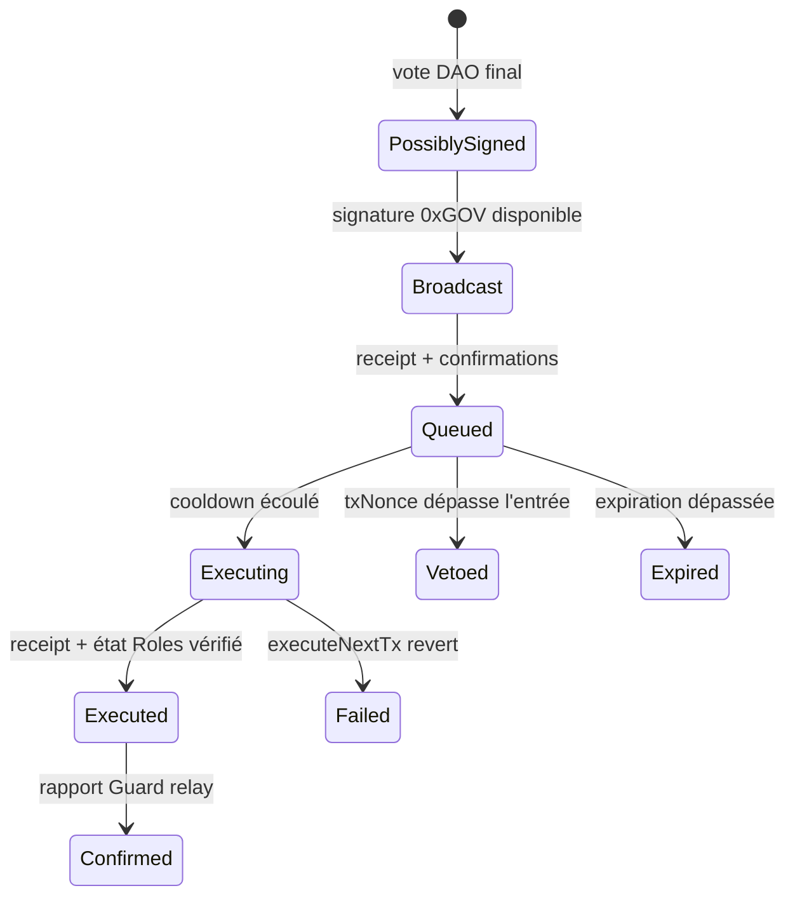

# MandateOS — Architecture

**Statut : architecture cible. Le spike de gouvernance Sputnik DAO est implémenté et testé ; la chaîne de paiement Phase 1 ne l'est pas encore.**

MandateOS permet à des agents IA de demander des opérations sur la trésorerie d'une entreprise sans détenir de clé EVM. Chaque opération doit être acceptée par trois composants indépendants : Guard, le Vault NEAR du client et Zodiac Roles devant son Safe Base.

Le projet vise la track **06 — AI Security & Defense** du hackathon NEAR 2026. Le développement local utilise NEAR Sandbox. L'UAT utilise **NEAR testnet comme plan de contrôle et Base Sepolia comme plan d'exécution**, avec des actifs de test et une allowance de 5 USDC. La production cible NEAR mainnet + Base mainnet après validation de l'UAT ([réseaux NEAR][near-networks], [réseaux Base][base-networks]).

## Périmètre

| Phase | Opérations | Statut requis |
|---|---|---|
| **Phase 1** | Paiement USDC depuis un Safe Base vers un fournisseur enregistré | Doit fonctionner de bout en bout avant toute extension |
| **Phase 2 — stretch** | Dépôt vers NEAR Intents, swap, puis retrait/bridge vers un wallet enregistré | Architecture cible ; ne doit pas être annoncé comme implémenté avant une preuve on-chain |
| **Roadmap** | Comptes de vote passkey, code global Vault/relay, preuves de statut Base | Hors hackathon tant que Phase 1 n'est pas stable |

Le MVP de démonstration reste mono-client côté flux de paiement, mais l'onboarding testnet accepte plusieurs organisations. `factory-v2.mandateos.testnet`, permissionless et sans access key, crée une DAO Sputnik globale par Company avec le dépôt fourni par le fondateur. Chaque membre doit prouver le contrôle de ses wallets par NEP-413 et EIP-191 ; une déclaration admin non signée reste hors du council. En mode UAT explicite, MandateOS réserve puis crée/finance le wallet client juste avant la création DAO, sous plafond journalier PostgreSQL ; l'inscription ne dépense aucun NEAR. Le serveur ne signe ni création ni policy. L'API finance séparément les Vault/relay sans access key, puis chaque membre les atteste depuis le RPC NEAR avant le déploiement Safe.

Le spike exécutable se trouve dans `contracts/` et ses résultats dans [`docs/dao-spike.md`](./docs/dao-spike.md).

## Invariants

1. Un agent n'a aucune clé EVM et ne soumet jamais un hash arbitraire à signer.
2. Le Vault construit la transaction canonique à partir d'une intention structurée.
3. Guard ne signe qu'une opération déjà préparée et identifiée par `op_id` et `tx_digest`.
4. Le Vault vérifie la signature Guard, la version de policy, la version du registre, l'expiration et l'unicité de `visa_nonce` avant tout appel MPC.
5. Une seule réservation est active par agent.
6. Un budget et une référence sont réservés avant l'appel asynchrone au MPC.
7. Zodiac revalide sur Base la cible, la fonction, les paramètres et l'allowance.
8. Une transaction soumise ne peut pas être rouverte par Guard.
9. Le relayer ne modifie et ne signe rien ; il diffuse une transaction brute déjà signée.
10. Une policy modifiée n'entre en vigueur qu'après la gouvernance applicable à sa cible.
11. Une nouvelle policy reste inactive tant que le Vault et Zodiac n'ont pas confirmé la même version ; Guard l'active en dernier.
12. Une déclaration de wallets n'accorde aucune autorité : NEP-413, clé NEAR full-access on-chain et EIP-191 doivent tous être vérifiés avant l'inclusion au council.
13. Safe ne peut être déployé ni la Treasury enregistrée avant la confirmation, par chaque membre prouvé, du même digest Vault/relay vérifié par RPC.

Ces invariants sont des exigences MandateOS. Les primitives externes qui les rendent possibles sont documentées dans les sections correspondantes.

## Vue d'ensemble



NEAR Chain Signatures produit des signatures secp256k1 à partir du compte NEAR appelant et d'un path de dérivation ; le contrat MPC mainnet est `v1.signer` ([MPC README][near-mpc]). L'interface publique du contrat fixe les types sérialisés utilisés par les appelants ([interface MPC][mpc-interface]).

## Composants

| Composant | Phase | Responsabilité | Source technique |
|---|---:|---|---|
| Console | 1 | Inscription email + passkey à partir d'un contexte signé court ; adhésion par preuves NEP-413/EIP-191 plutôt que par email ; lecture RPC et confirmation des déploiements ; NEAR Wallet Selector et MetaMask/Rabby pour signer. | [Better Auth passkey][better-auth-passkey] |
| API TypeScript | 1 | Backend HTTP Hono : Guard, authentification, clients, agents, policies, fournisseurs, opérations et relayer. | [Hono][hono] |
| Relayer NEAR sponsor | 1 | Reçoit un `SignedDelegateAction`, applique l'allowlist MandateOS et paie le gas NEAR depuis un compte relayer financé. | [Meta-transactions NEAR][near-meta-transactions], [guide relayer][near-relayer-guide] |
| Identité agent | 1 | Client credentials Better Auth pour Guard ; compte NEAR avec une function-call key générée côté client pour le Vault. | [Better Auth OAuth provider][better-auth-oauth], [access keys NEAR][near-access-keys] |
| PostgreSQL + Prisma | 1 | Source de vérité off-chain ; Prisma porte le schéma, les migrations, les transactions et l'accès typé aux données. | [Prisma ORM][prisma], section [Policy et registre](#policy-et-registre) |
| Compilateur de policy | 1 | Valide et normalise un snapshot, puis produit les artefacts Guard, Vault et Zodiac. | `packages/policy`, section [Compilation](#compilation) |
| Guard | 1 | Règles métier exactes, escalades, visas ed25519, confirmations Base. | Spécification MandateOS, section [Visa Guard](#visa-guard) |
| Vault | 1 | Rôles, budgets, allowlists, réservations, nonces, construction EIP-1559 et appels MPC. | [near-sdk][near-sdk], [`omni-transaction`][omni-transaction] |
| Relayer | 1 | Récupère la transaction signée et appelle le RPC Base. | [RPC Ethereum `eth_sendRawTransaction`][eth-send-raw] |
| Trezu / Sputnik DAO v2 | 1 | Gouvernance humaine du Vault et du relais ; seuil minimal 2/3. | [Sputnik DAO v2][sputnik] |
| Relais de gouvernance | 1 cible | Transforme une décision Trezu approuvée en transaction Safe signée par `0xGOV`. | [pattern multi-chain DAO][multichain-dao] |
| Safe + Zodiac Roles | 1 | Safe détient les fonds ; Roles contrôle les appels des adresses `0xAAA`. | [Safe][safe], [Roles Modifier][zodiac-roles] |
| NEAR Intents | 2 | Compte `0xINT`, dépôt POA, swap par solvers et retrait. | [contrats Intents][near-intents], [vue d'ensemble][intents-overview] |

Guard applique uniquement des règles déterministes. Une opération non couverte ou ambiguë est placée en escalade humaine ; l'absence de règle ne produit jamais un visa.

## Contrats externes et versions

Aucune adresse MandateOS n'est inventée dans cette spécification. Les adresses finales seront publiées après vérification du bytecode et du réseau.

| Dépendance | Version/cible | Fait utilisé | Source |
|---|---|---|---|
| MPC Chain Signatures | `v1.signer` mainnet ; `v1.signer-prod.testnet` testnet | Méthode `sign`, domaine ECDSA et path de dérivation | [MPC README][near-mpc], [interface MPC][mpc-interface] |
| `omni-transaction` | `0.3` | Construction EIP-1559, `build_for_signing`, assemblage avec signature | [dépôt][omni-transaction] |
| Zodiac Roles | v2, Base et Base Sepolia | `execTransactionWithRole`, cibles, fonctions et conditions de paramètres | [README et déploiements Roles][zodiac-roles] |
| Zodiac Delay | 1.1.1 | FIFO, cooldown UAT `300 s`, production `86 400 s`, expiration `604 800 s`, veto par `setTxNonce` | [référence Delay 1.1.1][zodiac-delay-reference], [source Solidity épinglée][zodiac-delay-1.1.1-source] |
| ModuleProxyFactory | 1.2.0 | Déploiement des modules Zodiac | [dépôt Zodiac][zodiac] |
| SafeL2 / SafeProxyFactory | 1.4.1 | Safe Base et factory de proxy | [registre SafeL2][safe-l2-deployment], [registre SafeProxyFactory][safe-proxy-factory] |
| Safe MultiSendCallOnly | 1.4.1, Base Sepolia `0x9641…02e2` | DelegateCall batch limité à des appels enfants `Call`; cible immutable du relay | [registre Safe deployments][safe-deployments], [`treasury-plan.ts`](./packages/deployer/src/treasury-plan.ts) |
| USDC UAT Base Sepolia | `TestUSDC (token de test)`, `0x418A…9474` | ERC-20 de test à 6 décimales, 20 unités frappées au deployer ; aucune valeur réelle | [`packages/deployer/contracts/TestUSDC.sol`](./packages/deployer/contracts/TestUSDC.sol) |

Le déploiement UAT observé est : Safe `0x19C…199cD`, Roles `0x7178…ed40`, Delay `0xDd86…9533`, TestUSDC (token de test) `0x418A…9474`, `0xAAA` `0x10Ed…37Af` et `0xGOV` `0xC963…FDBb`. Les adresses complètes, owners, modules, hashes de bytecode et transactions sont dans [`deployments/base-sepolia.json`](./deployments/base-sepolia.json).

Les allowances Roles sont indexées par une clé globale `bytes32` dans le stockage du contrat ; partager cette clé entre plusieurs rôles permet un plafond commun. L'opérateur `EqualTo` fixe une valeur de paramètre dynamique, par exemple le destinataire de `USDC.transfer` ([contrats Roles][zodiac-roles-contracts]).

Safe accepte les signatures ECDSA `(r, s, v)` de ses owners humains 2/3 ([format des signatures Safe][safe-signatures]). `0xGOV` n'est pas owner : il signe une transaction EIP-1559 qui appelle le module Delay. Le setup humain du Safe utilise le MultiSend général pour activer les modules ; la proposition 0xGOV utilise exclusivement **MultiSendCallOnly**. Le relay n'autorise `operation = DelegateCall` que vers son adresse MultiSendCallOnly immutable et attestée, tandis que les quatre enfants Roles restent des `Call` ([Safe][safe], [MultiSend][safe-multisend], [`governance-relay`](./contracts/governance-relay/src/lib.rs)).

`omni-transaction` 0.3 est retenu pour la Phase 1, mais son dépôt ne publie pas de rapport d'audit. Cette dépendance reste un risque explicite avant tout usage de production ([dépôt `omni-transaction`][omni-transaction]).

## Comptes et clés

| Identité | Clé ou autorité | Usage |
|---|---|---|
| Membres ACME | Wallets NEAR standards | Voter dans Trezu ; au moins trois membres, seuil minimal deux sur trois |
| DAO Trezu ACME | Policy Sputnik | Owner logique du Vault et du relais de gouvernance |
| Compte Vault ACME | Aucune access key après déploiement | Exécute uniquement son code ; appelle le MPC pour les paths agents et Intents |
| Agent | Client Better Auth + une function-call key NEAR générée localement | Appelle uniquement les méthodes autorisées du Vault ; aucune clé EVM |
| Guard | Clé ed25519 de service | Signe visas et confirmations ; sa clé publique est gouvernée dans le Vault |
| `0xAAA` | Adresse EVM dérivée de `(compte Vault, path agent)` | Membre d'un rôle Zodiac ; reçoit un petit solde ETH pour le gas |
| Relais de gouvernance | Aucune access key après déploiement | Reçoit uniquement les décisions Trezu et appelle le MPC pour son path |
| `0xGOV` | Adresse EVM dérivée de `(compte relais, path gouvernance)` | Module autorisé du Delay, ou membre du Roles administratif intermédiaire ; jamais owner du Safe |
| Security council Safe | Trois humains, clés matérielles, seuil 2/3 | Owners du Safe ; veto du Delay et actions d'urgence uniquement |
| Safe ACME | Security council owner 2/3 | Détient les USDC ; owner de Roles et du Delay ; avatar/target des deux modules |
| `0xINT` | Adresse dérivée de `(compte Vault, path Intents)` | Compte NEAR Intents dédié en Phase 2 ; aucune clé enregistrée |

Une function-call key NEAR peut être limitée à un receiver et à une liste de méthodes ; elle ne donne pas un accès complet au compte ([documentation access keys][near-access-keys]). `mandateos agent init` génère la clé localement ; le relayer crée ensuite `<slug>-agent.<parent>` avec une unique clé limitée au Vault et à `prepare`, `authorize`, `cancel_nonce`, `request_derived_public_key` ([`packages/sdk/src/cli.ts`](./packages/sdk/src/cli.ts), [`apps/api/src/near.ts`](./apps/api/src/near.ts)). Son allowance est illimitée (`null`) afin que l'unique clé ne devienne pas inutilisable après épuisement d'une allowance finie ; la dépense reste bornée par le solde libre du compte. Ces quatre méthodes reçoivent un dépôt nul ; le Vault paie lui-même le yoctoNEAR de ses appels MPC.

L'adresse dérivée dépend de l'identité du compte appelant le MPC et du path. Un agent qui appelle le MPC depuis son propre compte obtient donc une adresse différente de `0xAAA`, non assignée au rôle Zodiac ([Chain Signatures][chain-signatures]).

## Server keys

| Clé serveur | Périmètre autorisé | Incapacité structurelle |
|---|---|---|
| Guard ed25519 | Signer les visas et les rapports terminaux `Executed` / `Vetoed` / `Expired` / `Failed` sur le hash exact de transactions déjà engagées | Ne peut ni signer ni choisir une transaction EVM. Une clé compromise peut toutefois déclarer `Failed` avant diffusion et libérer le relay alors que la transaction 0xGOV déjà signée reste diffusable ; si elle entre dans Delay, le veto 2/3 du council reste la barrière. Risque résiduel : désordre ou blocage de file, pas transaction arbitraire. |
| Relayer NEAR | Déployer les comptes sponsorisés, financer leur réserve gas, soumettre `report_status` et les récupérations `submit_signature` | N'obtient aucune clé sur Vault/relay/agent ; l'unique clé agent créée est celle fournie par le client et reste FunctionCall-only |
| Gas wallet EVM | Signe uniquement l'appel permissionless `Delay.executeNextTx` préparé et checkpointé par le worker ; la diffusion des transactions brutes déjà signées utilise `eth_sendRawTransaction` sans cette clé | N'est ni owner Safe, ni module, ni membre Roles ; ne peut choisir ni cible, ni calldata, ni politique ([`apps/api/src/governance-base.ts`](./apps/api/src/governance-base.ts)) |

Pour l'UAT CallOnly, le gas wallet observé est
`0x37d679d9aE6dC2e14b662C3646aCd0d36B72E90d`. Il a soumis les appels
permissionless `executeNextTx` des entrées Delay de cette trésorerie et avait
aussi relayé le veto `0xcff3…527b` de l'UAT précédente. Ce second fait est un
historique opérationnel, pas une autorité supplémentaire : `setTxNonce` avait
déjà été autorisé par les signatures 2/3 du Safe, et le wallet n'est ni owner,
ni module, ni membre Roles
([`apps/api/src/governance-worker.ts`](./apps/api/src/governance-worker.ts),
[`docs/api.md`](./docs/api.md)).

Le provisionnement est implémenté par une seule transaction
`CreateAccount → Transfer → AddKey(FunctionCall)` ; l'API et le navigateur
relisent ensuite `view_access_key_list` et exigent exactement une clé conforme,
avec `allowance = null`
([`apps/api/src/agent-provisioning.ts`](./apps/api/src/agent-provisioning.ts),
[`apps/console/src/wallets.ts`](./apps/console/src/wallets.ts)). La fiche agent
et le worker alertent sous `NEAR_AGENT_GAS_LOW_YOCTO` ; la résolution est un
simple transfert NEAR au compte existant, sans changer sa clé
([`apps/api/src/console-data.ts`](./apps/api/src/console-data.ts),
[`apps/api/src/operation-worker.ts`](./apps/api/src/operation-worker.ts)).

Après `set_role` puis `register_agent`, le SDK lit `get_agent`. Il appelle
`request_derived_public_key` une seule fois si `evm_address` est vide, puis
attend le callback avant `prepare`. Le test Sandbox sans dépôt a mesuré
`6.306 Tgas`. Les mesures testnet sont `3.144851013726 Tgas` pour `prepare` et
`14.311476888041 Tgas` pour `authorize`; le SDK attache respectivement `10` et
`50 Tgas`, car `authorize` réserve aussi `15 Tgas` pour le MPC et `20 Tgas`
pour son callback ([`packages/sdk/src/index.ts`](./packages/sdk/src/index.ts),
[`contracts/vault/src/lib.rs`](./contracts/vault/src/lib.rs),
[`docs/api.md`](./docs/api.md)).

## Modèle multi-client et coût NEAR

Le suffixe `mandateos.testnet` fournit un namespace, pas du stockage gratuit. Chaque organisation garde des comptes d'état séparés : une DAO Sputnik, un Vault et un relais de gouvernance. Cette séparation est intentionnelle :

- le Vault et le relais sont des appelants MPC distincts, donc `0xAAA` et `0xGOV` restent compartimentés ;
- une faute de configuration ou de contrôle d'accès chez un client ne partage pas de state avec un autre client ;
- après le batch `CreateAccount → Transfer → DeployContract → new`, aucun des deux comptes n'a d'access key et la DAO est leur seule autorité logique.

Au protocole testnet version 88, le RPC publie `storage_amount_per_byte = 10^19` yoctoNEAR et `1 NEAR = 10^24` yoctoNEAR : 100 000 octets immobilisent 1 NEAR ([stockage NEAR][near-storage]). Les mesures du 21 octobre 2026 sont :

| Compte / action | Stockage observé ou sandbox | Minimum storage | Dépôt configuré | Marge |
|---|---:|---:|---:|---:|
| Factory MandateOS permissionless (une fois) | 150 623 octets on-chain | 1,50623 NEAR | 2 NEAR | 0,49377 NEAR |
| DAO Sputnik global `trezu-proof` | 810 octets on-chain | 0,00810 NEAR | 0,25 NEAR | 0,24190 NEAR |
| Vault WASM courant + `new` | 439 560 octets sandbox, sans access key | 4,39560 NEAR | 5 NEAR | 0,60440 NEAR |
| Relais WASM courant + `new` | 285 313 octets sandbox, sans access key | 2,85313 NEAR | 3,5 NEAR | 0,64687 NEAR |
| Wallet membre avec une clé | 182 octets on-chain | 0,00182 NEAR | 0,5 NEAR à la création DAO en mode démo | 0,49818 NEAR pour bond et gas |

La factory MandateOS `factory-v2.mandateos.testnet` est déployée une fois et n'a aucune access key. Le fondateur appelle `create`, paie les 0,25 NEAR depuis son wallet, signe la policy affichée, puis la factory référence le hash global immuable. En mode UAT démo, le navigateur génère la clé et MandateOS ne crée/finance le compte qu'immédiatement avant ce call ; l'API vérifie l'identité liée, réserve durablement le sponsoring et applique le plafond UTC quotidien. Hors démo, aucun secret n'est écrit en localStorage : le fondateur utilise NEAR Wallet Selector.

Ces soldes ne sont pas des frais par paiement. Le chemin réel `authorize → MPC → callback` a consommé 14,288425743215 Tgas ; au prix testnet observé de `10^8` yoctoNEAR/gas, cela vaut environ **0,00142885 NEAR** ([gas NEAR][near-gas]). Il n'y a pas d'erreur de 24 décimales dans les constantes.

Le sponsor est volontairement réservé à la démo hackathon. Le navigateur lit directement `get_policy` via le RPC NEAR, exige la confirmation du council et du seuil, puis autorise le déploiement Vault/relay. Après ce déploiement sponsorisé, chaque membre prouvé lit directement les comptes et vues Vault/relay (`code_hash`, clés, owner, MPC/path, chain, token, Guard/TTL et delay) et confirme le même digest avant Safe. `auto_update: true` reste un avertissement : la factory keyless n'expose aucune méthode d'update et la DAO référence un hash immuable.

La factory réutilise Sputnik au lieu de réécrire la gouvernance. Le contrat est compatible avec l'UI Sputnik officielle de Trezu configurée pour testnet ; le backend hébergé `testenv.trezu.app` refuse toutefois actuellement les suffixes personnalisés. Publier Vault et relay comme global contracts devient rentable à partir d'environ dix instances, mais exige environ 72,5 NEAR brûlés une fois ([global contracts NEAR][near-global-contracts]).

Les builds reproductibles de la factory, du Vault et du relay pinent l'image
`sourcescan/cargo-near:0.20.3-rust-1.86.0` par digest. Leurs hashes sont séparés
des bytecodes UAT déjà déployés ; aucun artefact keyless n'est remplacé implicitement.

## Déploiement d'ACME

Le seed et le script de déploiement mono-client exécutent et vérifient les étapes suivantes :

1. `scripts/seed-acme.ts` crée le client, les membres, l'agent, les fournisseurs, le rôle et le premier draft en PostgreSQL ;
2. le compilateur valide le draft et crée un snapshot canonique immuable ;
3. créer/configurer la DAO Trezu avec au moins trois membres et un seuil de deux sur trois ;
4. remplacer la policy Sputnik par des permissions explicites ;
5. déployer le Vault sur un compte ACME et l'initialiser avec `client_id`, la DAO owner, la clé publique Guard et les paramètres réseau ;
6. supprimer toutes les access keys du compte Vault ;
7. dériver les adresses `0xAAA`, puis les préfinancer avec un petit montant d'ETH par action gouvernée ;
8. déployer le Safe Base Sepolia avec trois owners de test distincts et un seuil 2/3 ;
9. déployer Roles v2 et Delay 1.1.1 avec `owner = avatar = target = Safe`, `cooldown = 300` secondes sur Base Sepolia (`86 400` en production) et `expiration = 604 800` secondes ;
10. activer Roles et Delay comme modules du Safe, autoriser le vrai `0xGOV` dérivé dans Delay, puis configurer chaque mandat par un unique batch MultiSendCallOnly (`assignRoles`, `scopeTarget`, `scopeFunction`, `setAllowance`) ;
11. créer les comptes agents et ajouter leurs function-call keys générées localement ;
12. enregistrer adresses, versions, hashes de bytecode et transactions dans la table `deployments`, puis publier les liens explorateurs dans le README.

Les suppressions et permissions de clés doivent être vérifiées par les vues RPC NEAR prévues à cet effet ([RPC comptes et contrats][near-rpc-contracts]). Les versions Safe et Roles sont vérifiées dans leurs registres de déploiement respectifs ([Safe deployments][safe-deployments], [Roles deployments][zodiac-roles]).

## Monorepo

MandateOS est un monorepo indépendant. Il n'importe, ne copie et ne lie aucun code de JOIN ; seuls certains principes d'identité machine et de gestion locale des clés ont servi d'inspiration.

```text
MandateOS/
├── apps/
│   ├── api/                   # Backend TypeScript Hono
│   └── console/               # Interface humaine
├── contracts/
│   ├── vault/                 # Contrat Rust NEAR
│   └── governance-relay/      # Trezu → MPC → 0xGOV
├── packages/
│   ├── auth/                  # Passkeys humains et client credentials agents
│   ├── agent-wallet/          # Clé NEAR locale et function-call calls
│   ├── db/                    # Schéma Prisma, migrations et client généré
│   ├── protocol/              # Types, Borsh, visas, statuts et vecteurs TS/Rust
│   ├── policy/                # Validation, normalisation et compilation
│   ├── sdk/                   # API publique des agents
│   └── cli/                   # Administration et déploiement
├── scripts/
│   ├── seed-acme.ts           # Données de démonstration PostgreSQL
│   └── deploy-acme/           # Déploiement mono-client
├── tests/
│   └── fixtures/              # Fixtures déterministes, pas de configuration active
├── deployments/               # Manifestes d'adresses et preuves vérifiées
├── pnpm-workspace.yaml
└── Cargo.toml
```

`pnpm` gère les workspaces TypeScript et Cargo les contrats Rust. Le Guard hackathon lit le registre exact `config/clients/acme/vendors.json`; la cible multi-client publie ces versions depuis PostgreSQL et aucun service de production ne lit alors une policy depuis le filesystem.

### Backend TypeScript

`apps/api` est un service TypeScript Hono. Il assemble les routes et middlewares, puis délègue la logique métier à des modules explicites :

```text
apps/api/src/
├── app.ts                     # Construction de l'application Hono
├── server.ts                  # Écoute HTTP et arrêt propre
├── middleware/
│   ├── auth.ts                # Session humaine ou client credentials
│   └── client-scope.ts        # Dérive client_id, ne lit pas le body
└── modules/
    ├── agents/
    ├── clients/
    ├── policies/
    ├── vendors/
    ├── operations/
    ├── guard/
    ├── relayer/
    └── watcher/
```

`packages/db` contient `prisma/schema.prisma`, les migrations et l'unique client Prisma partagé par l'API. Les routes Hono ne construisent pas de règles financières : elles valident l'entrée, appellent le service métier et sérialisent la réponse. Les transactions Prisma bornent la création d'un snapshot, de ses versions et de ses artefacts compilés ([Hono][hono], [transactions Prisma][prisma-transactions]).

### Financement des transactions NEAR

MandateOS finance les appels NEAR des agents par des meta-transactions NEP-366. L'agent conserve sa function-call key mais aucun solde NEAR libre : il signe hors chaîne un `DelegateAction`, puis le backend Hono soumet le `SignedDelegateAction` dans une transaction payée par le compte relayer MandateOS ([meta-transactions NEAR][near-meta-transactions]).

Le relayer refuse toute action qui ne respecte pas simultanément :

- `sender_id` rattaché à l'agent Better Auth et au `client_id` ;
- `receiver_id` égal au Vault enregistré du client ;
- une seule action `FunctionCall` ;
- méthode dans l'allowlist `prepare`, `authorize`, `expire` ou `cancel_nonce` ;
- aucun transfert, staking, ajout/suppression de clé ou suppression de compte ;
- dépôt attaché nul sur les appels agents ;
- nonce et `max_block_height` valides ;
- quota de gas sponsorisé disponible dans PostgreSQL.

Le protocole exécute les actions comme si l'agent les avait envoyées : le Vault continue donc de voir l'agent comme `predecessor_account_id`, et les restrictions de la function-call key sur le receiver et les méthodes restent appliquées. Son allowance de gas n'est pas débitée, puisque le relayer paie le coût ([contraintes Function Call keys et meta-transactions][near-meta-transactions]).

L'appel `authorize` lui-même n'attache aucun dépôt. Le Vault attache le 1 yoctoNEAR requis à `v1.signer-prod.testnet` depuis son propre petit solde opérationnel, financé par MandateOS ou par la DAO. Le relayer finance le gas de la transaction externe ; le Vault finance ses receipts sortants et les coûts de stockage.

Le endpoint cible est `POST /near/relay`. Il décode la transaction avant soumission, applique les règles ci-dessus, journalise le coût par client et signe l'enveloppe avec un compte relayer séparé. Une panne du relayer bloque les nouvelles opérations mais ne donne aucun pouvoir supplémentaire sur le Vault. Le guide officiel décrit ce modèle de serveur financé et recommande de filtrer receiver, sender et actions avant relais ([guide relayer NEAR][near-relayer-guide]).

## Policy et registre

### Source de vérité

La console est l'interface d'édition. PostgreSQL, accédé par Prisma, est la source de vérité off-chain. Le Vault et Zodiac restent les sources de vérité pour les règles effectivement actives sur leurs chaînes.

Le modèle minimal comprend :

| Table | Clé principale | Contenu |
|---|---|---|
| `organization` | `id` | Organisation Better Auth, nom, slug, métadonnées |
| `member` | `id` | Appartenance `(organizationId, userId)` et rôle `owner`, `admin` ou `member` |
| `agent` | `id` | `authUserId` Better Auth, organisation, compte NEAR, clé publique, Vault, rôle, path MPC, statut |
| `apikey` | `id` | Credential agent haché, `referenceId = authUserId`, activation et rate limit |
| `organization_environments` | `(organizationId, environment)` | Réseaux et composants déployés |
| `vendor` | `(organizationId, id)` | Fournisseur et statut |
| `vendor_addresses` | `(client_id, vendor_id, chain)` | Destinations autorisées |
| `contracts` | `(client_id, reference_id)` | Abonnements, commandes et règles d'idempotence |
| `roles` | `(client_id, id)` | Opérations, plafonds, budget et limites de gas |
| `policy_drafts` | `(client_id, environment, id)` | Modifications non actives |
| `policy_snapshots` | `(client_id, environment, version)` | Document canonique immuable et son hash |
| `registry_snapshots` | `(client_id, environment, version)` | Registre canonique immuable et son hash |
| `compiled_artifacts` | `(client_id, environment, policy_version, target)` | Artefacts Guard, Vault et Zodiac |
| `deployments` | `(client_id, environment, component)` | Adresse, version, code hash, tx hash |

Toutes les contraintes et requêtes métier sont préfixées par `organizationId`. L'API le dérive de la session Better Auth (`activeOrganizationId`, avec relecture de `member`) ou de la clé API de l'agent ; elle ne fait jamais confiance à un `organizationId` fourni dans le body. Une session console et une clé agent ne sont jamais interchangeables : la route agent n'accepte que `x-api-key`, les routes console que le cookie de session. La route d'urgence est réservée aux membres et écrit deux lignes d'audit (`requested`, puis `submitted` ou `rejected`) dans `audit_log`.

Les secrets ne sont pas enregistrés dans les snapshots. PostgreSQL conserve uniquement une référence KMS. Chaque client et environnement possède sa propre clé Guard afin qu'une compromission ne permette pas de signer pour un autre Vault.

### Onboarding et mandats (implémenté)

`apps/api/src/treasury.ts` construit un plan non signé (DAO, Vault, relay, Safe/Roles/Delay). Le fondateur signe localement la création DAO après affichage de la policy ; le navigateur compare ensuite directement `get_policy` avec chaque membre attendu et le seuil absolu. Avant d'enregistrer une `Treasury`, l'API vérifie : hash global du DAO égal à `get_default_code_hash()` de la factory, council, seuil, `RoleWeight`, quorum `0`, absence de rôles concurrents, paramètres Vault/relay, owners/seuil/modules du Safe et cooldown du Delay. `auto_update: true` produit l'avertissement audité `dao_auto_update_enabled` sans bloquer le statut `active`, car la factory est keyless, sans méthode d'update, et le code DAO est référencé par hash immuable.

`apps/api/src/mandates.ts` compile un rôle en trois artefacts : config `set_role` du Vault, permission Zodiac (`scopeTarget`, `scopeFunction` avec conditions de destinataires et allowance, `assignRoles`) et policy Guard. Il renvoie un diff déterministe et des propositions Trezu non signées ; le serveur ne signe jamais ([`apps/api/src/treasury.ts`](./apps/api/src/treasury.ts), [`apps/api/src/mandates.ts`](./apps/api/src/mandates.ts), [`packages/deployer/src/roles-policy.ts`](./packages/deployer/src/roles-policy.ts)).

### Compilation

`packages/policy` reçoit un draft typé, pas un fichier. Son pipeline est déterministe :

```text
draft PostgreSQL
  → validation stricte
  → résolution agents/fournisseurs/déploiements
  → normalisation des montants et adresses
  → tri canonique
  → snapshot immuable + content_hash
  → GuardRules
  → VaultRoleConfig
  → ZodiacPermissions
```

Les montants normalisés sont des entiers en unités minimales. Les champs inconnus sont rejetés. `packages/protocol` fournit la sérialisation Borsh et des vecteurs de test partagés entre TypeScript et Rust.

| Donnée | Guard | Vault | Zodiac |
|---|---|---|---|
| Client | `client_id` de la session | `client_id` initialisé dans le Vault | Safe et Roles dédiés au client |
| Agent et rôle | Client Better Auth | `predecessor_account_id` et rôle on-chain | Adresse `0xAAA` assignée au rôle |
| Fournisseur | Snapshot de registre | Allowlist d'adresses | Condition `EqualTo(recipient)` |
| Montant par transaction | Règle exacte | `max_per_tx` | Condition/allowance |
| Budget de période | Miroir pour l'interface | Réservation et consommation on-chain | Allowance périodique |
| Référence | Contrat ou commande | Réservée puis consommée | Non représentée |
| Gas | Valeurs du snapshot | Plafond par champ et coût total | Non représenté |

### Cycle d'activation

Une modification suit la machine suivante :

```text
Draft → Validated → Proposed → VaultApplied → ZodiacQueued → Cooldown → ZodiacApplied → Active
```

1. la version active continue à servir les paiements ;
2. la console crée un draft et affiche son diff ;
3. le compilateur crée un snapshot et les trois artefacts ;
4. Trezu applique l'artefact Vault ;
5. `0xGOV` met l'artefact Zodiac en file dans Delay ;
6. le security council dispose de 300 secondes en UAT, 24 heures en production, pour vérifier ou opposer son veto ;
7. après le cooldown, n'importe qui exécute la tête de file ;
8. l'API vérifie que le Vault et Zodiac exposent la version et le hash attendus ;
9. Guard active le snapshot en dernier.

Guard refuse un visa si `client_id`, `policy_version` ou `registry_version` ne correspondent pas à l'opération préparée et aux versions actives. Une policy partiellement appliquée n'est jamais utilisée pour émettre de nouveaux visas.

### Seed ACME et montée en charge

`scripts/seed-acme.ts` utilise `packages/db` et les mêmes services métier que la console pour insérer les données de démonstration. Les tests utilisent `tests/fixtures`, sans créer une deuxième source de vérité.

Le stockage est scalable par client sans changer Guard ou le compilateur :

- clés et index composites préfixés par `client_id` ;
- cache préfixé par `(client_id, environment, version)` ;
- transaction Prisma pour publier atomiquement un snapshot et ses artefacts ;
- Row-Level Security possible lorsque l'isolation applicative doit être renforcée ;
- workers de compilation et de déploiement partitionnés par client ;
- clé Guard KMS distincte par client et environnement.

Le MVP n'a qu'ACME, mais aucun schéma ou chemin de code n'est spécifique à son nom.

## Phase 1 — paiement USDC Base

### Types canoniques

Les structures persistées par le Vault utilisent Borsh afin de produire un encodage déterministe ([Borsh specification][borsh], [sérialisation near-sdk][near-serialization]). Les adresses sont stockées en 20 octets et les montants en unités minimales.

```rust
PaymentIntent {
    chain_id: u64,
    role: String,
    token: [u8; 20],
    recipient: [u8; 20],
    amount: u128,
    reference: String,
}

PreparedOperation {
    op_id: [u8; 32],
    client_id: String,
    agent: AccountId,
    intent: PaymentIntent,
    policy_version: u64,
    registry_version: u64,
    evm_nonce: u64,
    transaction: Eip1559Transaction,
    tx_digest: [u8; 32],
    prepared_at_block: u64,
    expires_at_block: u64,
    state: OperationState,
}

GuardVisa {
    op_id: [u8; 32],
    client_id: String,
    tx_digest: [u8; 32],
    agent: AccountId,
    role: String,
    reference: String,
    policy_version: u64,
    registry_version: u64,
    visa_nonce: u64,
    expires_at: u64,
}
```

La transaction EIP-1559 contient au minimum `chain_id`, `nonce`, `to`, `value`, `data`, `max_priority_fee_per_gas`, `max_fee_per_gas` et `gas_limit`. `omni-transaction` construit le préimage RLP, que l'appelant hash en Keccak-256 pour le domaine ECDSA, puis assemble la transaction brute avec la signature ([README `omni-transaction`][omni-transaction]).

### `prepare(intent)`

`prepare` est appelé par la function-call key de l'agent. La méthode ne demande aucune signature MPC.

1. vérifier que le Vault n'est pas en pause ;
2. identifier l'agent avec `predecessor_account_id` et vérifier qu'il appartient au `client_id` immuable du Vault ;
3. vérifier qu'il n'a aucune réservation active ;
4. vérifier rôle, expiration, chaîne, token, destinataire, montant et budget ;
5. vérifier que la référence n'est ni réservée ni consommée ;
6. créer `op_id`, réserver le budget et la référence ;
7. affecter le prochain nonce EVM disponible de `0xAAA` sans l'avancer définitivement ;
8. construire l'appel `execTransactionWithRole(USDC, 0, transfer(recipient, amount), Call, roleKey, true)` ;
9. fixer les champs de gas, vérifier chaque plafond et `max_fee_per_gas × gas_limit ≤ max_total_fee` ;
10. construire la transaction EIP-1559 et calculer `tx_digest` ;
11. persister l'état `Préparée` et retourner `op_id`, `tx_digest` et l'expiration.

L'interface `execTransactionWithRole` et les contrôles de cible/fonction/paramètres viennent de Roles v2 ([Roles Modifier][zodiac-roles]).

### Visa Guard

Guard reçoit `op_id`, relit l'opération au moyen d'une vue du Vault et applique uniquement des règles exactes :

- le `client_id` dérivé du credential Better Auth correspond à l'opération et au Vault ;
- l'identité Better Auth correspond à `agent` ;
- le fournisseur et son adresse correspondent à `registry_version` ;
- le contrat ou la commande autorise la référence et le montant ;
- la policy autorise l'opération ;
- les champs gas restent dans la policy ;
- l'opération n'est pas expirée.

Tout cas non couvert devient une escalade humaine. Une escalade approuvée reprend le même chemin et reste soumise au Vault et à Zodiac.

Le message signé est exactement :

```text
UTF8("mandateos:visa:v1") || BORSH(GuardVisa)
```

Guard le signe en ed25519. Le Vault vérifie la signature avec `env::ed25519_verify`, fonction exposée par near-sdk ([référence near-sdk][near-ed25519-verify]). Le préfixe de domaine empêche de réutiliser la même signature pour un autre type de message MandateOS.

### `authorize(op_id, visa)`

1. charger une opération en état `Préparée` ;
2. exiger que l'appelant soit l'agent de l'opération ;
3. reconstruire le message canonique et vérifier la signature Guard ;
4. comparer `client_id`, `op_id`, `tx_digest`, `agent`, `role`, `reference`, `policy_version` et `registry_version` ;
5. vérifier l'expiration et les versions courantes de la policy et du registre ;
6. refuser tout `visa_nonce` déjà consommé, puis le consommer avant l'appel externe ;
7. passer immédiatement l'opération à `PossiblySigned` et avancer `next_evm_nonce` ;
8. appeler `sign` sur le contrat MPC avec le path agent et le digest EIP-1559 ;
9. dans le callback privé, stocker la signature si elle est disponible, sans modifier les réservations en cas d'échec ou de timeout ;
10. si le callback échoue, arrive en retard ou est ignoré, n'importe qui peut appeler `submit_signature(op_id, signature)` : le contrat accepte la signature uniquement si `env::ecrecover` retrouve l'adresse `0xAAA` dérivée pour le digest exact de la transaction originale ou de l'annulation en cours, puis stocke `signature` et `signed_transaction`. `submit_signature` ne libère ni budget, ni référence, ni nonce.

L'invariant de sécurité est conservateur : **une signature MPC est considérée publique dès l'appel à `sign`**. Les réponses MPC sont publiées dans les arguments de `respond` sur NEAR ; ignorer une réponse dans le callback du Vault ne rend donc pas la signature secrète ([source du contrat MPC][mpc-contract-source]). `submit_signature` est sans permission parce que son seul effet est de stocker une signature cryptographiquement valide pour un digest déjà engagé. `report_status` et `confirm_original` acceptent aussi `(big_r, s, recovery_id)` en argument et passent par le même contrôle `ecrecover` avant de comparer le hash. Le Vault verrouille budget, référence et nonce avant l'appel MPC. Un échec du callback, une réponse tardive, un timeout, `pause` ou `revoke_agent` ne libère aucun de ces éléments ([`contracts/vault/src/lib.rs`](./contracts/vault/src/lib.rs)).

L'appel cible `v1.signer-prod.testnet` en UAT et `v1.signer` en production. Le wire format est `sign({ request: { path, payload_v2: { Ecdsa }, domain_id } })`. Le signer testnet exige au moins 1 yoctoNEAR et 10 Tgas ; le Vault réserve environ 50 Tgas pour l'appel et son callback jusqu'à mesure finale sur la version déployée ([MPC README][near-mpc], [interface MPC][mpc-interface]).

### Réservation, expiration et nonce

- une seule opération non terminale existe par agent ; cette règle sérialise aussi les nonces de chaque `0xAAA` ;
- le TTL de préparation est court et gouverné dans la policy ;
- `expire(op_id)` ne fonctionne qu'en état `Préparée`, avant `authorize` ;
- cette expiration libère budget et référence, et la réservation suivante réutilise le nonce ;
- `authorize` avance le nonce avant l'appel MPC : à partir de `PossiblySigned`, il n'est jamais réutilisé pour une nouvelle opération ;
- un échec ou timeout MPC laisse l'opération en `PossiblySigned`, même si le callback ne reçoit aucune signature ;
- `pause` et `revoke_agent` interdisent les nouvelles opérations, conservent toute réservation `PossiblySigned` et autorisent le worker d'urgence à appeler `cancel_nonce` sans être l'agent ; avant le coupe-circuit, seuls l'agent ou l'owner DAO peuvent demander l'annulation.

Les écritures de réservation, la consommation de `visa_nonce`, le passage à `PossiblySigned` et l'avancement du nonce précèdent l'appel cross-contract. Deux exécutions concurrentes ne peuvent donc ni dépenser le même budget ni réutiliser un nonce potentiellement signé ([sécurité cross-contract][near-reentrancy], [échecs de callbacks][near-callback-failures], [`contracts/vault/src/lib.rs`](./contracts/vault/src/lib.rs)).

## Machine à états



| État | Fonds/budget | Sortie autorisée |
|---|---|---|
| `Réservée` | Mutation atomique interne à `prepare` | `Préparée` ; tout échec de construction revert l'appel |
| `Préparée` | Budget et référence réservés ; nonce réutilisable | `PossiblySigned`, `Expirée` |
| `PossiblySigned` | Budget, référence et nonce verrouillés ; signature supposée publique | `Confirmée` après succès de l'original, ou `Cancelled` après succès de l'annulation |
| `Confirmée` | Budget et référence consommés | terminal |
| `Cancelled` | Budget libéré ; référence réutilisable ; nonce consommé sur Base | terminal |
| `Expirée` | Réservation libérée ; nonce réutilisable car `sign` n'a jamais été appelé | terminal |

`Signée`, `Soumise`, `Bloquée` et `Revert` sont des observations opérationnelles d'une opération `PossiblySigned`, pas des états qui autorisent une libération. Cette représentation empêche un callback en échec ou un rapport incomplet de rouvrir un nonce potentiellement signé ([`contracts/vault/src/types.rs`](./contracts/vault/src/types.rs), [`contracts/vault/src/lib.rs`](./contracts/vault/src/lib.rs)).

### Transaction bloquée et `cancel_nonce`

`cancel_nonce(op_id, gas_limit, max_fee_per_gas, max_priority_fee_per_gas)` construit une transaction EIP-1559 sur Base avec le même nonce, `to = 0xAAA`, `value = 0` et un calldata vide. Les frais doivent être strictement supérieurs à la tentative précédente tout en restant sous les plafonds du rôle. Avant un coupe-circuit, l'appelant doit être l'agent ou l'owner ; après `pause` ou `revoke_agent`, le worker d'urgence peut déclencher l'annulation. Le Vault la fait signer par le même path MPC. Le callback ne libère rien ; si le callback d'annulation échoue, `submit_signature` stocke la signature publiée pour le digest d'annulation. Après inclusion Base, la DAO confirme le hash de la transaction d'annulation, puis seulement le Vault passe à `Cancelled` ([`contracts/vault/src/evm.rs`](./contracts/vault/src/evm.rs), [`contracts/vault/src/lib.rs`](./contracts/vault/src/lib.rs), [transactions Ethereum][ethereum-transactions]).

Une annulation et la transaction originale partagent le même nonce : une seule peut être incluse. Une réponse MPC originale tardive après l'annulation reste sans effet sur la comptabilité ; le nonce déjà consommé ne redevient jamais disponible.

### Transaction revertée

Un revert consomme le nonce Base mais ne libère ni budget ni référence. Guard ne peut pas rouvrir l'opération. Une décision Trezu explicite reste nécessaire pour toute résolution comptable ou nouvelle tentative ; aucune transition automatique n'existe dans le Vault actuel.

## Gas Base et relayer

Chaque `0xAAA` détient un petit solde ETH. Une recharge normale est une action administrative votée dans Trezu puis mise en file par `0xGOV` dans Delay. En urgence, le security council peut recharger directement par une transaction Safe 2/3 journalisée.

Le Vault couvre dans `tx_digest` :

- `maxPriorityFeePerGas` ;
- `maxFeePerGas` ;
- `gasLimit` ;
- tous les autres champs de la transaction EIP-1559.

Il vérifie également `maxFeePerGas × gasLimit` contre le plafond de frais du rôle. Le relayer reçoit uniquement le raw transaction produit après la signature MPC et le transmet à `eth_sendRawTransaction` ([RPC Ethereum][eth-send-raw]). Une modification d'un octet invalide la signature.

Le worker est un processus séparé, singleton par lease PostgreSQL expirante. Il
ne fait confiance ni à son état mémoire ni à une réponse RPC précédente : à
chaque reprise il relit l'opération du Vault, recalcule le hash de la
transaction brute, consulte le receipt Base avant toute rediffusion et
réconcilie les états terminaux. Le hash de la transaction NEAR `authorize`,
enregistré par l'agent, permet d'extraire une réponse MPC secp256k1 publiée dans
les receipt outcomes et d'appeler `submit_signature` si le callback a échoué.

Après un receipt Base réussi, le worker signe `report_status` avec Guard. Un
revert reste verrouillé et exige la gouvernance. Une transaction sans receipt
peut être remplacée par `cancel_nonce` seulement si le Vault est en pause ou
l'agent révoqué, conformément au contrôle d'accès on-chain. Le worker diffuse
ensuite l'annulation mais attend `confirm_cancellation` par la DAO avant de
libérer la référence PostgreSQL. Les références `Expired` sont également
libérées ; les références `Confirmed` et `Reverted` ne le sont jamais.

## Rapports de statut

Le Vault ne lit pas directement Base dans la Phase 1. Après un receipt réussi de la transaction originale, Guard signe :

```text
UTF8("mandateos:status:v1") || BORSH({
  client_id,
  op_id,
  kind: Confirmed,
  tx_hash,
  report_nonce,
  block_number
})
```

Le Vault vérifie la signature ed25519, l'unicité de `report_nonce` et l'égalité de `tx_hash` avec le hash de la transaction brute originale qu'il a stockée. Si le callback MPC a échoué, la transaction brute est d'abord reconstruite par `submit_signature` à partir de la signature publique ; `report_status` refuse alors toujours de confirmer sans cette transaction stockée. Ce rapport permet uniquement `PossiblySigned → Confirmée` ; il ne peut ni annuler, ni recréditer, ni rouvrir une opération. La confirmation d'une annulation est réservée à l'owner DAO via `confirm_cancellation` ([`contracts/vault/src/lib.rs`](./contracts/vault/src/lib.rs), [RPC Ethereum][ethereum-json-rpc]).

Le relais de gouvernance applique le même modèle avec le domaine séparé
`mandateos:relay-status:v1`. Le rapport couvre `client_id`, `op_id`, le hash de
la transaction 0xGOV brute stockée, un nonce unique et le bloc Base. Le
contrat vérifie la signature et le hash, mais ne prouve pas lui-même le receipt
Base : le Guard nominal n'émet le rapport qu'après exécution et vérification
Roles par le worker. `confirm_original` owner-only reste le secours DAO. Une
clé Guard volée peut libérer prématurément la file du relais et provoquer un
décalage/DoS de nonce, mais elle ne signe aucune transaction EVM et ne modifie
ni policy ni fonds ([`contracts/governance-relay/src/lib.rs`](./contracts/governance-relay/src/lib.rs),
[`apps/api/src/guard.ts`](./apps/api/src/guard.ts)).

## Gouvernance

### Pattern UAT : security council, Roles et Delay

L'UAT utilise NEAR testnet comme plan de contrôle et Base Sepolia comme plan d'exécution. Le Safe Base Sepolia conserve trois owners distincts avec un seuil 2/3. En production, ces owners deviennent trois clés matérielles humaines ; on-chain, ils conservent l'autorité complète du Safe.

Le Safe active deux chemins séparés, inspirés du [Zodiac Key Challenge][zodiac-key-challenge] :

1. **Opérations agents sans délai** : `0xAAA → Roles opérationnel → Safe`. Roles impose cible, fonction, paramètres et allowance.
2. **Administration avec délai** : `Trezu → relais NEAR → MPC → 0xGOV → Delay 300 s → Safe → Roles`. La production remplace `300 s` par `86 400 s`.

Dans le Key Challenge, des clés opérateur compromises ont mis 27 transactions en file ; le security council les a toutes invalidées, tandis que les sorties directes sont restées bornées par les permissions et budgets Roles ([debrief et wiring][zodiac-key-challenge], [constellation de référence][key-challenge-constellation]).



### Relais réel et machine à états

Chaque nouvelle trésorerie reçoit un relais keyless dont l'owner immuable est sa
DAO. L'initialisation atteste `client_id`, le path MPC, le chain ID, le Delay,
la clé Guard et l'adresse canonique Safe MultiSend 1.4.1. `propose` accepte
`operation = Call` vers toute cible, mais `operation = DelegateCall` uniquement
si `target == multisend_address`; toute autre délégation revert explicitement
`ERR_DELEGATECALL_TARGET`. Le Delay reçoit et stocke l'opération exacte dans son
calldata ([`contracts/governance-relay/src/lib.rs`](./contracts/governance-relay/src/lib.rs),
[`contracts/governance-relay/src/evm.rs`](./contracts/governance-relay/src/evm.rs),
[`apps/console/src/wallets.ts`](./apps/console/src/wallets.ts)).

Le worker découvre l'opération active, récupère une signature MPC manquante
depuis le receipt NEAR du vote final, checkpoint le hash et le `queueNonce`
avant diffusion, puis attend `WORKER_CONFIRMATIONS`. Il lit `txCooldown`,
`txExpiration` et `txCreatedAt` directement sur Delay. Après cooldown, la clé
gas signe uniquement `executeNextTx`; la transaction brute et son hash sont
persistés avant diffusion pour rendre la reprise après crash idempotente. Un
revert devient `Failed` sans retry ; `txNonce > entryNonce` devient `Vetoed` et
une entrée trop vieille devient `Expired`. Après succès, le worker vérifie le
membre Roles, l'allowance et les quatre événements de configuration avant le
rapport Guard ([`apps/api/src/governance-worker.ts`](./apps/api/src/governance-worker.ts),
[`apps/api/src/governance-base.ts`](./apps/api/src/governance-base.ts)).



### Wiring et ownership

- **Owners du Safe** : security council humain 2/3.
- **Owner de Roles** : le Safe.
- **Owner du Delay** : le Safe.
- **Avatar et target du Delay** : le Safe.
- **Modules du Safe** : Roles opérationnel et Delay.
- **Module autorisé du Delay** : `0xGOV` dérivé par le relais NEAR de la trésorerie (`0x3961FA54D0ebDf4DbDe073466f580D48Daac7928` pour la PR C UAT).
- **Membres des rôles opérationnels** : adresses `0xAAA`.

Delay 1.1.1 stocke un cooldown et une expiration lors de `setUp`; son owner, avatar et target sont configurés séparément ([`Delay.sol:L34-L85`][zodiac-delay-setup-source]). Seuls les modules activés peuvent appeler `execTransactionFromModule`, qui ajoute le hash et l'horodatage à la file puis incrémente `queueNonce` ([`Delay.sol:L121-L168`][zodiac-delay-queue-source]). Après le cooldown, n'importe qui peut exécuter la tête de file ; Delay vérifie le hash, l'expiration et l'ordre FIFO avant de transmettre au Safe ([`Delay.sol:L170-L201`][zodiac-delay-execute-source]).

### Veto et urgence

Le security council fait signer au Safe un appel `Delay.setTxNonce(newNonce)`. Cette fonction owner-only exige un nonce supérieur à `txNonce` et inférieur ou égal à `queueNonce`, puis saute toutes les entrées précédentes ([`Delay.sol:L108-L119`][zodiac-delay-veto-source], [référence Delay][zodiac-delay-reference]). Pour annuler toute la file connue, le council fixe `newNonce = queueNonce`.

Le council peut aussi désactiver un module, révoquer un rôle ou déplacer les fonds directement par une transaction Safe 2/3. Ce pouvoir est intentionnellement réservé aux incidents ; il constitue le principal risque de centralisation du montage.

### Option renforcée : Roles administratif

Sans filtre intermédiaire, un `0xGOV` compromis peut mettre n'importe quel appel Safe en file ; la sécurité dépend alors du veto pendant le cooldown. L'UAT utilise ce montage direct pour tester toute la chaîne. L'option de production renforcée place un second Roles entre `0xGOV` et Delay :

```text
0xGOV → Roles administratif → Delay 24 h → Safe → Roles opérationnel
```

Le Roles administratif n'autorise que les fonctions d'administration nécessaires sur le Roles opérationnel : gestion des rôles, membres, cibles, fonctions, conditions et allowances. Il interdit les transferts de fonds, les changements d'owners Safe et l'activation de modules. Le Safe est owner des deux Roles. Cette option est recommandée avant la production Base mainnet.

### Disponibilité

Une panne de NEAR testnet, du relais ou du MPC empêche de proposer de nouveaux changements via `0xGOV`, mais ne retire pas les owners humains du Safe. Le security council peut administrer le Safe en urgence. Les paiements agents déjà autorisés continuent par le chemin Roles direct tant que le Vault et le MPC restent disponibles.

### Configuration Sputnik

Sputnik évalue les permissions par rôle et son rôle par défaut autorise `*:AddProposal`; cette permission large doit être remplacée par des permissions explicites limitées aux propositions MandateOS ([`policy.rs`][sputnik-policy]). Les rôles sont évalués en OU : un membre ne doit donc appartenir à aucun rôle plus permissif que le rôle MandateOS.

Une proposition `Transfer` avec `msg` exécute `ft_transfer_call`. Le Vault peut utiliser ce message pour créer/configurer un rôle et lui créditer son budget atomiquement ; une configuration invalide retourne les fonds selon le standard FT ([`ProposalKind::Transfer`][sputnik-proposals], [sécurité `ft_transfer_call`][near-ft-transfer-call]).

La proposition `FactoryInfoUpdate` contrôle les informations de factory et l'auto-update. La configuration ACME la verrouille afin qu'aucun upgrade automatique ne contourne le vote explicite prévu pour le code du Vault ([`ProposalKind::FactoryInfoUpdate`][sputnik-proposals]).

### Spike automatisé

Le workspace `contracts/` déploie Sputnik DAO, le Vault et le relais sans access key dans NEAR Sandbox. Neuf tests DAO, dix tests Vault et six tests relais passent. La suite DAO prouve le seuil explicite de deux membres, les appels directs refusés, le financement par `ft_transfer_call`, la création et le financement atomiques, la proposition non-membre refusée, la désactivation de l'auto-update et l'expiration. Le vote qui atteint le seuil et appelle le Vault a consommé 8,788 Tgas lors de la mesure locale.

La suite Vault couvre visas, budgets, références, concurrence, expiration avant `authorize`, `PossiblySigned`, réponse MPC tardive, récupération de signature après callback en échec pour l'original et l'annulation, pause, révocation, annulation au même nonce, rapports de confirmation et dérivation `0xAAA`. La suite relais couvre owner DAO, nonce séquentiel, callback tardif, récupération de signature, `Confirmed` et `Cancelled`. En UAT, 1 TestUSDC (token de test) a été payé par le Vault ; la gouvernance a porté l'allowance à 10 TestUSDC (token de test) après Delay ; une proposition à 1 000 TestUSDC (token de test) a ensuite été veto par `setTxNonce(3)`, et `executeNextTx` a revert. Les preuves sont dans les deux manifests de déploiement.

### Security council et seuils

Trezu et le security council utilisent chacun au moins trois membres et un seuil explicite de deux signatures. Les listes peuvent partager les mêmes personnes au MVP, mais les clés NEAR et Base restent distinctes. Les clés Base sont matérielles et conservées hors des systèmes MandateOS. Toute opération directe du council doit être journalisée comme veto ou urgence.

Le seuil Sputnik `"2"` est un poids absolu. Toute modification du council passe par une proposition `ChangePolicy` qui met à jour simultanément le groupe et le seuil `ceil(2 × nombre_de_membres / 3)` ; les raccourcis `AddMemberToRole` et `RemoveMemberFromRole` sont interdits pour ce rôle.

## Phase 2 — NEAR Intents

La Phase 2 est un stretch. Elle n'est pas nécessaire à la validation de la Phase 1.

### Compte dédié `0xINT`

Le Vault utilise un path MPC séparé pour dériver `0xINT`. Le Verifier Intents accepte les payloads `erc191`, récupère une clé secp256k1 depuis la signature et convertit cette clé en identifiant implicite `0x…` ([`payload/multi.rs`][intents-multi], [`payload/erc191.rs`][intents-erc191], [`public_key.rs`][intents-public-key]). Le Vault fait signer chaque intent par le MPC ; aucune clé n'est enregistrée pour `0xINT`.

Le path Intents ne réutilise ni le path agent Base ni le path de gouvernance.

### Dépôt Base vers Intents

Le service POA expose `deposit_address` sur `https://bridge.chaindefuser.com/rpc`. La requête utilise :

```json
{
  "account_id": "0xINT",
  "chain": "eth:8453"
}
```

L'adresse retournée est stable pour ce compte et peut recevoir plusieurs dépôts ; l'exemple officiel la décrit comme une adresse source-chain liée au compte Intents ([exemple `get-token-deposit-address.ts`][intents-deposit-example]). La règle Zodiac est limitée à :

```text
USDC.transfer(
  to == DEPOSIT_ADDR_0XINT,
  amount withinAllowance(INTENTS_PERIOD_BUDGET)
)
```

Le token crédité dans Intents pour l'USDC Base est le suivant ([documentation Intents][intents-docs]) :

```text
nep141:base-0x833589fcd6edb6e08f4c7c32d4f71b54bda02913.omft.near
```

Les paramètres vérifiés pour la conception sont un dépôt minimum de `0,15 USDC` et des frais de retrait de `0,0024 USDC`. Le script doit relire le registre et l'API bridge au déploiement, car les tokens supportés et frais sont des paramètres de service ([documentation Intents][intents-docs], [bridge RPC][intents-bridge-rpc]).

### Swap

1. Guard fournit la référence de prix et sa version ;
2. le client demande un `quote` au Message Bus `https://solver-relay-v2.chaindefuser.com/rpc` avec la clé API du Partner Portal ([documentation Intents][intents-docs]) ;
3. le Vault vérifie token entrant, token sortant, montant, deadline et minimum reçu contre la référence Guard ;
4. le Vault construit le payload, le fait signer pour `0xINT`, puis autorise `publish_intent` ([documentation Intents][intents-docs]) ;
5. le statut est suivi sans permettre au service off-chain de modifier l'intent signé.

NEAR Intents décrit le flux comme une intention, une compétition de solvers, une quote puis un règlement par le Verifier ([vue d'ensemble Intents][intents-overview]). Les formats internes ne sont pas annoncés comme API stable par le dépôt ; l'intégration doit épingler une version testée ([README Intents][near-intents]).

### Bridge / retrait

Le bridge utilise un intent `ft_withdraw`. Le Vault vérifie :

- token autorisé ;
- montant dans le budget restant ;
- wallet de destination présent dans le registre client ;
- chaîne autorisée ;
- deadline et nonce Intents ;
- format canonique du payload ERC-191.

Le format exact du memo POA vers Base reste ouvert et doit être confirmé contre la version courante de la documentation et du bridge avant implémentation ([documentation Intents][intents-docs]).

### Limite de protection

Après le dépôt, les fonds crédités à `0xINT` ne sont plus détenus par le Safe et ne passent plus par Zodiac. Ils sont protégés par le contrôle du Vault sur les signatures Intents. `0xINT` ne conserve donc que le budget de la période ; l'exposition Phase 2 maximale est ce solde, sous réserve d'une défaillance du protocole Intents ou du MPC.

## Modèle de menace

### Hypothèses

- NEAR, Base, Chain Signatures, Safe, Zodiac Roles, Delay 1.1.1 et NEAR Intents suivent leurs règles publiées.
- Moins de deux clés du security council Safe sont compromises.
- Le council surveille la file Delay et peut intervenir pendant les `300 s` UAT ; la production rétablit `86 400 s`.
- Les wallets humains requis pour le seuil Trezu ne sont pas tous compromis.
- Les adresses, versions, ownerships, modules et bytecodes externes sont vérifiés au déploiement.
- Les contrats MandateOS n'ont pas encore été audités ; l'UAT Base Sepolia n'utilise que TestUSDC (token de test).

### Scénarios

| Scénario | Guard | Vault | Zodiac / gouvernance Base | Perte maximale visée |
|---|---|---|---|---|
| Appel `authorize` sans visa | — | Refus | — | 0 |
| Visa modifié, expiré ou rejoué | — | Refus signature/digest/expiry/nonce | — | 0 |
| Deux `prepare` simultanés | — | Une réservation active par agent | — | 0 |
| Référence déjà réservée ou consommée | Refus ou escalade | Refus | Allowance borne le résiduel | 0 doublon |
| Réponse MPC tardive | — | Reste `PossiblySigned`, nonce non réutilisable | Une seule tx du nonce peut être incluse | 0 réutilisation de nonce |
| Callback MPC en échec ou timeout | — | Budget, référence et nonce restent verrouillés | Annulation au même nonce requise | Déni de service jusqu'à annulation |
| `pause` ou `revoke_agent` après `sign` | — | Réservation conservée ; signal d'annulation | Le worker diffuse l'annulation signée | Déni de service, pas de double dépense |
| Faux rapport d'annulation par Guard | Compromis | Refus : seul l'owner DAO confirme l'annulation | — | 0 |
| Agent appelle directement le MPC | — | Adresse dérivée différente | Refus : adresse non membre | 0 |
| Destinataire modifié | Registre | Allowlist et digest | `EqualTo(recipient)` | 0 |
| Agent `0xAAA` compromis | Partiel | Budget du rôle | Permission et allowance immédiates, sans Delay | Budget/allowance du rôle |
| Frais Base gonflés | Visa couvre la tx | Plafonds champ + coût total | Solde ETH de `0xAAA` borne le résiduel | Plafond gas |
| Relayer malveillant | — | Tx déjà signée | Une modification invalide la signature | Déni de service |
| Clé Guard compromise | Contourné | Rôle, budget, allowlist ; aucune annulation comptable | Allowance et paramètres | Budget/allowance du rôle |
| Vault compromis en Phase 1 | — | Contourné | Cibles et allowances | Somme des allowances financées jusqu'à intervention |
| Vault compromis en Phase 2 | — | Contourné | Pas de Zodiac sur `0xINT` | Solde de période de `0xINT` |
| NEAR testnet ou relais compromis | — | Potentiellement contourné | Peut mettre des changements en file via `0xGOV`; cooldown et veto restent actifs | 0 si veto à temps ; sinon impact du changement |
| `0xGOV` compromis sans Roles administratif | — | — | Peut mettre tout appel Safe en file | Tous les fonds si council absent pendant le cooldown |
| `0xGOV` compromis avec Roles administratif | — | — | Ne peut mettre en file que les fonctions d'administration autorisées | Paramètres/allowances modifiables après délai |
| Spam de la file Delay | — | — | Bloque la FIFO ; le council avance `txNonce` | Déni de service jusqu'au veto |
| Delay mal configuré ou compromis | — | — | Délai trop court, file bloquée ou contournée | Changements administratifs non contrôlés |
| Deux clés du security council compromises | — | — | Contrôle direct du Safe, des modules et des fonds | Totalité du Safe |
| Security council indisponible | — | — | Pas de veto ni d'urgence | Changement malveillant exécutable après le cooldown |
| Rapport Guard mensonger | Compromis | Ne peut que confirmer l'original exact | Fonds déjà soumis sur Base | Erreur de comptabilité, pas de réouverture |
| Policy erronée | Applique l'erreur | Applique l'erreur | Applique l'erreur | Budget erroné approuvé |

### Risque commun de policy

Les trois verrous ont des implémentations séparées mais partagent une spécification. Une mauvaise adresse ou un budget trop élevé peut donc être compilé partout. Les contrôles sont :

- revue humaine du diff ;
- tests d'invariants sur les artefacts générés ;
- comparaison des versions actives ;
- vote Trezu ;
- Delay de `300 s` en UAT et `86 400 s` en production pour toute administration Base issue de `0xGOV` ;
- veto `setTxNonce` et actions d'urgence par le security council Safe 2/3 ;
- ownership Safe de Roles et Delay ;
- Roles administratif intermédiaire recommandé pour limiter `0xGOV` ;
- budgets, allowances et recharges limités.

### Hors modèle

- compromission simultanée du seuil humain et des contrats gouvernés ;
- rupture cryptographique de secp256k1 ou ed25519 ;
- défaillance de consensus de NEAR ou Base ;
- usage de montants de production avant audit.

## Critères de validation

La Phase 1 est implémentée uniquement si les preuves suivantes existent :

1. paiement TestUSDC (token de test) confirmé de bout en bout avec liens explorateurs NEAR et Base ;
2. Guard escalade un destinataire inconnu sans émettre de visa ;
3. Vault refuse un `prepare` dont le destinataire n'est pas dans son allowlist ;
4. Zodiac revert une transaction EVM signée envoyée directement ;
5. `authorize` sans visa, visa rejoué, modifié ou périmé refusés ;
6. callback MPC en échec ou tardif conservant budget, référence et nonce ;
7. `cancel_nonce` signe le même nonce et atteint `Cancelled` uniquement après confirmation ;
8. relais appelable uniquement par la DAO, nonce `0xGOV` séquentiel et état `PossiblySigned` ;
9. proposition Trezu 2/3 portée par `0xGOV`, Delay 300 secondes, puis allowance à 10 TestUSDC (token de test) ;
10. proposition malveillante mise en file, veto `setTxNonce`, puis `executeNextTx` refusé ;
11. owners, seuil, modules, versions et hashes externes vérifiés sans adresse fictive.

## Points ouverts

- [ ] **Memo de retrait POA vers Base** : confirmer le format exact attendu par la version de bridge utilisée.
- [ ] **Source de prix de référence** : choisir et documenter la source indépendante utilisée par Guard pour le minimum reçu d'un swap.
- [x] **Trezu en un vote** : le spike prouve la création et le financement atomiques via `Transfer.msg → ft_transfer_call → ft_on_transfer`.
- [x] **Ordre des nonces de `0xGOV`** : le relais sérialise une seule opération active et avance le nonce avant tout appel MPC ; le smoke a utilisé les nonces `0`, `1` et `2`.
- [x] **Gas MPC exact** : le Vault a brûlé `14,288425743215 Tgas` sur le smoke réel ; le relais réserve 15 Tgas pour `sign` et 20 Tgas pour son callback.

## Sources

### NEAR et MPC

- [NEAR access keys][near-access-keys]
- [NEAR cross-contract calls et sécurité des callbacks][near-private-callbacks]
- [NEAR Chain Signatures][chain-signatures]
- [MPC README][near-mpc]
- [Interface du contrat MPC][mpc-interface]
- [`omni-transaction` 0.3][omni-transaction]

### Safe et Zodiac

- [Safe smart account][safe]
- [Format des signatures Safe][safe-signatures]
- [Déploiements Safe][safe-deployments]
- [Zodiac Roles Modifier][zodiac-roles]
- [Contrats Roles v2][zodiac-roles-contracts]
- [Zodiac][zodiac]
- [Zodiac Key Challenge][zodiac-key-challenge]
- [Constellation du Key Challenge][key-challenge-constellation]
- [Référence Delay 1.1.1][zodiac-delay-reference]
- [Source Solidity Delay 1.1.1 épinglée][zodiac-delay-1.1.1-source]

### Sources de gouvernance

- [Sputnik DAO v2][sputnik]
- [`policy.rs` Sputnik][sputnik-policy]
- [`proposals.rs` Sputnik][sputnik-proposals]
- [Tutoriel NEAR multi-chain DAO][multichain-dao]
- [Abstract DAO, sans licence déclarée][abstract-dao]

### Intents

- [Contrats NEAR Intents][near-intents]
- [`MultiPayload`][intents-multi]
- [Payload ERC-191][intents-erc191]
- [Conversion des clés en comptes implicites][intents-public-key]
- [Exemple de dépôt POA][intents-deposit-example]
- [Documentation Intents][intents-docs]

[near-networks]: https://docs.near.org/protocol/network/networks
[base-networks]: https://docs.base.org/base-chain/network-information
[near-access-keys]: https://docs.near.org/protocol/accounts-contracts/access-keys
[near-sdk]: https://docs.near.org/smart-contracts/what-is
[near-serialization]: https://docs.near.org/smart-contracts/anatomy/serialization
[near-ed25519-verify]: https://docs.rs/near-sdk/latest/near_sdk/env/fn.ed25519_verify.html
[near-private-callbacks]: https://docs.near.org/smart-contracts/security/cross-contract-calls/callbacks
[near-callback-failures]: https://docs.near.org/smart-contracts/security/cross-contract-calls/callback-failures
[near-reentrancy]: https://docs.near.org/smart-contracts/security/cross-contract-calls/reentrancy
[near-ft-transfer-call]: https://docs.near.org/smart-contracts/security/cross-contract-calls/ft-transfer-call
[near-rpc-contracts]: https://docs.near.org/api/rpc/contracts
[chain-signatures]: https://docs.near.org/chain-abstraction/chain-signatures
[near-mpc]: https://github.com/near/mpc/blob/main/README.md
[mpc-contract-source]: https://github.com/near/mpc/blob/main/chain-signatures/contract/src/lib.rs
[mpc-interface]: https://github.com/near/mpc/tree/main/crates/near-mpc-contract-interface
[omni-transaction]: https://github.com/near/omni-transaction-rs
[borsh]: https://borsh.io
[better-auth-passkey]: https://www.better-auth.com/docs/plugins/passkey
[better-auth-oauth]: https://www.better-auth.com/docs/plugins/oauth-provider
[eth-send-raw]: https://ethereum.org/developers/docs/apis/json-rpc/#eth_sendrawtransaction
[ethereum-json-rpc]: https://ethereum.org/developers/docs/apis/json-rpc/
[ethereum-transactions]: https://ethereum.org/developers/docs/transactions/
[safe]: https://github.com/safe-global/safe-smart-account
[safe-signatures]: https://github.com/safe-global/safe-smart-account/blob/main/docs/signatures.md
[safe-multisend]: https://github.com/safe-global/safe-smart-account/blob/main/contracts/libraries/MultiSend.sol
[safe-deployments]: https://github.com/safe-global/safe-deployments
[safe-l2-deployment]: https://github.com/safe-global/safe-deployments/blob/main/src/assets/v1.4.1/safe_l2.json
[safe-proxy-factory]: https://github.com/safe-global/safe-deployments/blob/main/src/assets/v1.4.1/proxy_factory.json
[zodiac]: https://github.com/gnosisguild/zodiac
[zodiac-roles]: https://github.com/gnosisguild/zodiac-modifier-roles
[zodiac-roles-contracts]: https://github.com/gnosisguild/zodiac-modifier-roles/tree/main/packages/evm/contracts
[sputnik]: https://github.com/near-daos/sputnik-dao-contract
[sputnik-policy]: https://github.com/near-daos/sputnik-dao-contract/blob/main/sputnikdao2/src/policy.rs
[sputnik-proposals]: https://github.com/near-daos/sputnik-dao-contract/blob/main/sputnikdao2/src/proposals.rs
[multichain-dao]: https://docs.near.org/chain-abstraction/chain-signatures/tutorials/multichain-dao/0-intro
[abstract-dao]: https://github.com/nearuaguild/abstract-dao
[near-intents]: https://github.com/near/intents
[intents-overview]: https://docs.near.org/chain-abstraction/intents/overview
[intents-docs]: https://docs.near-intents.org
[intents-multi]: https://github.com/near/intents/blob/main/contracts/defuse/core/src/payload/multi.rs
[intents-erc191]: https://github.com/near/intents/blob/main/contracts/defuse/core/src/payload/erc191.rs
[intents-public-key]: https://github.com/near/intents/blob/main/contracts/defuse/core/src/public_key.rs
[intents-deposit-example]: https://github.com/near-examples/near-intents-examples/blob/main/verifier-examples/get-token-deposit-address.ts
[intents-bridge-rpc]: https://bridge.chaindefuser.com/rpc
[hono]: https://hono.dev/docs/
[prisma]: https://www.prisma.io/docs/orm
[prisma-transactions]: https://www.prisma.io/docs/orm/prisma-client/queries/transactions
[zodiac-key-challenge]: https://www.zodiac.eco/key-challenge
[key-challenge-constellation]: https://github.com/jomoormann/key-challenge-constellation
[zodiac-delay-reference]: https://docs.zodiac.eco/developers/delay/reference
[zodiac-delay-1.1.1-source]: https://github.com/zodiaceco/zodiac-modifier-delay/blob/30f3aafa9b3be3425bcac390fe6ab6bd9afb5f16/contracts/Delay.sol
[zodiac-delay-setup-source]: https://github.com/zodiaceco/zodiac-modifier-delay/blob/30f3aafa9b3be3425bcac390fe6ab6bd9afb5f16/contracts/Delay.sol#L34-L85
[zodiac-delay-veto-source]: https://github.com/zodiaceco/zodiac-modifier-delay/blob/30f3aafa9b3be3425bcac390fe6ab6bd9afb5f16/contracts/Delay.sol#L108-L119
[zodiac-delay-queue-source]: https://github.com/zodiaceco/zodiac-modifier-delay/blob/30f3aafa9b3be3425bcac390fe6ab6bd9afb5f16/contracts/Delay.sol#L121-L168
[zodiac-delay-execute-source]: https://github.com/zodiaceco/zodiac-modifier-delay/blob/30f3aafa9b3be3425bcac390fe6ab6bd9afb5f16/contracts/Delay.sol#L170-L201
[near-meta-transactions]: https://docs.near.org/protocol/transactions/meta-tx
[near-relayer-guide]: https://docs.near.org/web3-apps/tutorials/meta-transactions
[near-storage]: https://docs.near.org/tutorials/auction/auction-factory
[near-gas]: https://near.github.io/nearcore/architecture/how/gas.html
[near-global-contracts]: https://github.com/near/NEPs/blob/master/neps/nep-0591.md
[near-dao]: https://docs.near.org/primitives/dao
