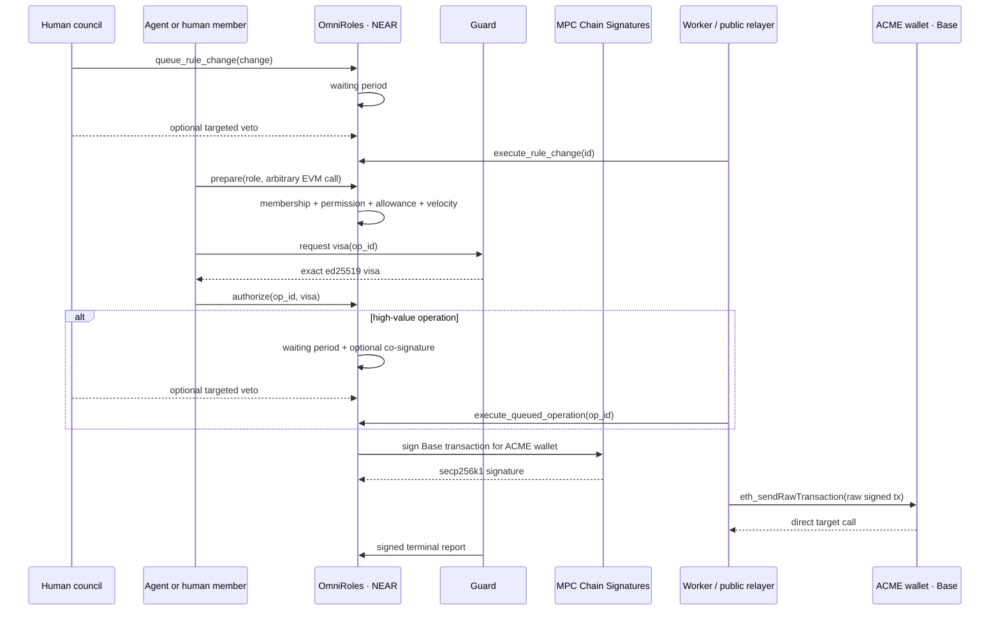
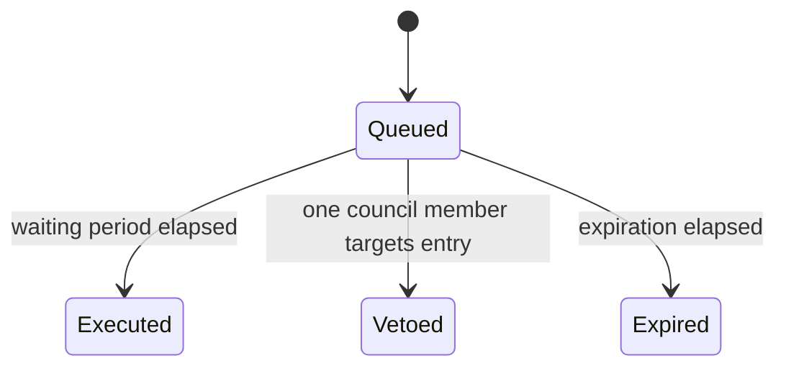
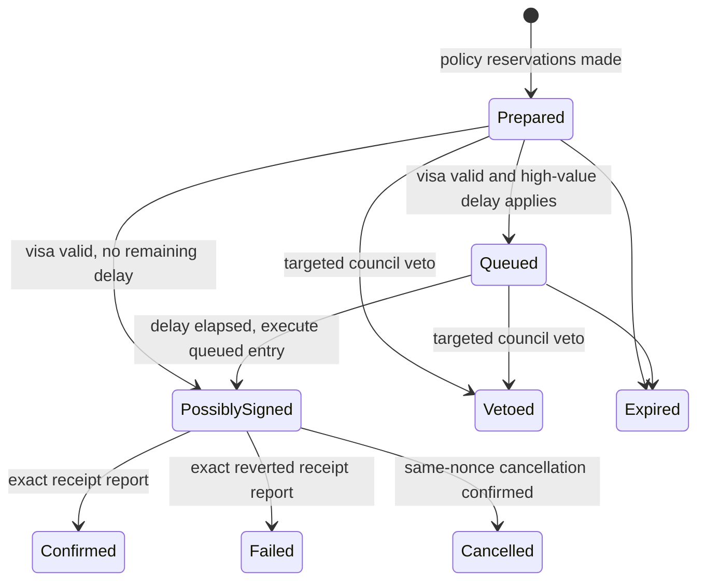

# MandateOS — OmniRoles architecture

## Decision

MandateOS uses **OmniRoles**, a keyless NEAR contract, as the single policy engine and wallet authority. Safe, the previous EVM role and delay modules, the governance relay, `0xAAA`, and `0xGOV` are no longer part of the target architecture. The November demo executes on NEAR testnet and Base Sepolia; other chains and off-chain signatures follow the same wallet/policy model later ([issue #40](https://github.com/joindefi/MandateOS/issues/40), [`contracts/vault/src/lib.rs`](./contracts/vault/src/lib.rs)).

The company has one MPC-derived wallet per chain. For Base Sepolia, the path is `omniroles/evm/84532`. The NEAR vault account and path determine the EVM address; no human or server holds its private key ([Chain Signatures](https://docs.near.org/chain-abstraction/chain-signatures), [`contracts/vault/src/lib.rs`](./contracts/vault/src/lib.rs)).

## System flow



## Authority and keys

| Principal | Authority | Keys held by MandateOS |
|---|---|---|
| Human company council | Sputnik votes; targeted veto of one queued rule or operation | None |
| Sputnik DAO | Logical `owner_id`; can only queue policy changes | None |
| OmniRoles vault | Policy state, allowance accounting, wallet nonce, MPC requests | No access key after deployment |
| Agent or human member | Function-call key limited to `prepare`, `authorize`, `cancel_nonce`, `renounce_role` | None |
| Guard | Business-data visas and terminal receipt reports | Separate ed25519 visa/status keys; neither can produce MPC signatures |
| Worker / relayer | Broadcasts exact raw transactions and calls permissionless queue execution | No fund-moving key |
| ACME Base wallet | Holds TestUSDC and a small ETH gas balance | MPC-derived; no private key exists |

The future paymaster is tracked in issue #39. Until then the derived Base wallet must hold enough ETH for `gas_limit × max_fee_per_gas`; OmniRoles caps all EIP-1559 fields before asking MPC to sign ([`contracts/vault/src/evm.rs`](./contracts/vault/src/evm.rs)).

## Contract invariants

1. One `ChainWallet` exists per `chain_id`; it owns one nonce stream and at most one active operation.
2. EVM transactions call the permitted target directly. No Safe module or `execTransactionWithRole` wrapper exists.
3. Every caller is a NEAR `AccountId`. Agents and humans use the same membership model.
4. Memberships can have a start, end, and maximum use count. Preparation reserves one use; only a confirmed operation consumes it. The member can renounce immediately.
5. Permissions bind chain, target, optional selector, condition bytes, and optional shared allowance key.
6. Allowances are global to the vault and therefore shared across chains. `balance`, `refill`, `max_refill`, `period_ns`, `timestamp_ns`, and `reserved` are stored on NEAR.
7. Velocity reservations and allowance reservations happen before any asynchronous MPC call and are released on veto, expiry, cancellation, or failed EVM execution.
8. A role or allowance with active reservations cannot be replaced.
9. Rule changes never apply immediately: the DAO queues them, anyone executes after the waiting period, and one council account may veto exactly one entry.
10. Operations above `operation_delay_threshold` are not signed until their waiting period ends. A targeted council veto releases only that operation.
11. Operations above `co_sign_threshold` require an active **human** member of the distinct `co_signer_role`; agents and members of the operation role cannot co-sign.
12. The wallet nonce advances only when OmniRoles commits to an MPC signing request. A vetoed or expired pre-signature operation does not consume it.
13. Once a raw transaction may exist, cancellation uses a higher-fee transaction with the same wallet nonce.
14. Guard visas bind `client_id`, operation, digest, member, role, reference, policy versions, nonce, and expiry. Replay is rejected.
15. Terminal reports bind the hash of the exact stored raw transaction. `Confirmed` consumes reservations; `Failed` releases policy spend but keeps the wallet nonce consumed.
16. Non-empty condition trees fail closed until `contracts/omniroles-conditions` is integrated.
17. A council member may pause immediately during an incident. Only the DAO owner can unpause.
18. Visa and status keys are separate and can rotate only through delayed `RuleChange` entries.

These invariants are implemented in [`contracts/vault/src/lib.rs`](./contracts/vault/src/lib.rs) and exercised by [`contracts/tests/tests/vault_operations.rs`](./contracts/tests/tests/vault_operations.rs) and [`contracts/tests/tests/dao_governance.rs`](./contracts/tests/tests/dao_governance.rs).

## Policy model

### Roles and memberships

A role contains:

- `enabled`;
- EVM permissions;
- high-value waiting-period threshold and duration;
- co-signature threshold;
- distinct human `co_signer_role`;
- velocity limit/window;
- EIP-1559 gas caps.

A membership contains `starts_at_ns`, optional `ends_at_ns`, optional `max_uses`, used/reserved counters, and an active flag. `renounce_role` is immediate and callable only by the member. Grants and administrative revocations are delayed `RuleChange` entries.

### Permissions and conditions

A permission binds:

```text
(chain_id, target, optional selector, flattened conditions, optional allowance_key)
```

Task 1a defines the integration boundary:

```rust
evaluate(conditions, calldata, EvaluationContext) -> Result<bool, EvaluationError>
```

The boundary is in [`contracts/vault/src/conditions.rs`](./contracts/vault/src/conditions.rs). Empty conditions are unconditional. Non-empty conditions return `EngineUnavailable`, and the vault reverts `ERR_CONDITION_ENGINE_UNAVAILABLE`. Task 1b will replace that fail-closed adapter with the independent `contracts/omniroles-conditions` crate; task 1a does not create or modify that crate.

Until task 1b lands, ERC-20 `transfer(address,uint256)` and native ETH value are decoded/bound internally for allowance accounting. Any other allowance-bearing calldata fails closed. Unconditional arbitrary contract calls without an allowance are supported now.

### Allowance refill

Before reservation, OmniRoles computes complete elapsed periods:

```text
periods = (now - timestamp) / period
balance = min(maxRefill, balance + periods × refill)
timestamp = timestamp + periods × period
available = balance - reserved
```

Proposal creation does not reset the timestamp. A delayed `SetAllowance` writes its timestamp only when the queued rule executes.

## Queues and state transitions

### Rule changes



`SetRole`, `RemoveRole`, `GrantMembership`, `RevokeMembership`, `SetAllowance`, `SetCouncil`, `SetVisaPublicKey`, `SetStatusPublicKey`, and `SetVersions` all use this queue.

### Operations



The per-chain wallet queue remains occupied until a terminal state, preventing nonce races and concurrent reservation ambiguity.

## Direct EVM execution

`OperationRequest` contains the chain, target, ETH value, raw calldata, allowance amount, reference, and EIP-1559 fields. After policy checks, [`contracts/vault/src/evm.rs`](./contracts/vault/src/evm.rs) constructs this transaction directly:

```text
from  = derived ACME wallet
nonce = ChainWallet.next_nonce
to    = permitted target
value = request.value
input = request.calldata
```

The SDK turns a business payment into canonical `ERC20.transfer(recipient, amount)` calldata and submits it with the agent role and Base chain ID ([`packages/sdk/src/index.ts`](./packages/sdk/src/index.ts)).

## Governance

Sputnik remains the human governance layer. The DAO is `owner_id`, but an approved proposal only **queues** a rule. The mandatory NEAR waiting period is enforced by OmniRoles itself, not by a Base contract. Council accounts stored in the vault can veto one rule entry or one delayed operation without advancing or clearing unrelated entries.

Transactions voted by the DAO (`submit_transactions`, reserved role `__dao__`) become `Scheduled` with `execute_after = now + rule_delay`. After the window, anyone can call `start_dao_transaction(chain_id)`, which starts the oldest transaction of that chain once the wallet is free there and assigns it the next nonce. The vault caps their fees (5M gas, 500 gwei, 0.5 ETH). The MPC path is `omniroles/evm`, so the company has one address on every EVM chain.

DAO sandbox tests prove:

- direct accounts cannot queue owner changes;
- the final Sputnik vote queues rather than immediately applying a rule;
- early execution fails;
- one council account vetoes one selected rule;
- another queued rule remains executable.

## Deployment and attestation

Task 1a deployment attests:

- keyless OmniRoles account and code hash;
- `owner_id`, MPC account, separate visa/status Guard keys, policy versions;
- council accounts;
- operation TTL, rule delay, and rule expiration;
- derived Base wallet path, public key, address, and nonce;
- zero access keys after initialization;
- wallet ETH/TestUSDC balances before the first payment.

The jury run recorded in [`deployments/omniroles-base-sepolia.json`](./deployments/omniroles-base-sepolia.json) uses a Sputnik DAO owner, three distinct council accounts, a 300-second rule delay, zero Vault access keys, separate Guard keys, a direct Base payment, and a terminal `Confirmed` report.

The old Safe, Roles, Delay, governance-relay and `0xGOV` attestations are obsolete; that code has been removed.

## Current delivery boundary

| Block | Status |
|---|---|
| Issue #37 invitation binding + four-eyes wallet approval | Merged in PR #36 |
| Issue #40 task 1a contract, SDK boundary, tests | This branch |
| Issue #40 task 1b condition engine | Parallel branch owned separately; this branch does not touch it |
| Issue #40 task 2 console/deployment cutover | Next PR after task 1a validation |
| Paymaster | Issue #39, later |

No component is called production-ready: contracts remain unaudited, Base Sepolia uses test assets, and the condition engine integration is intentionally fail-closed.
