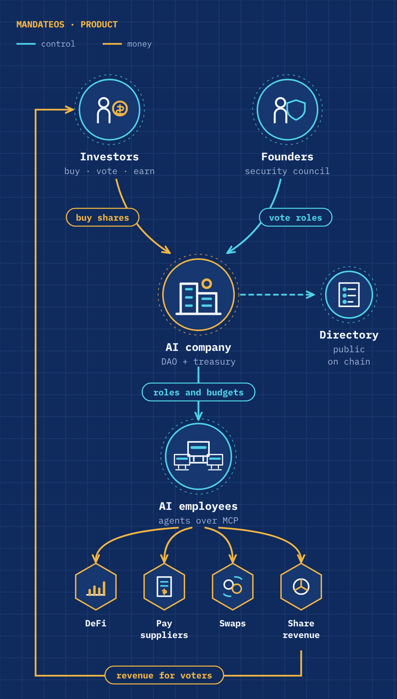
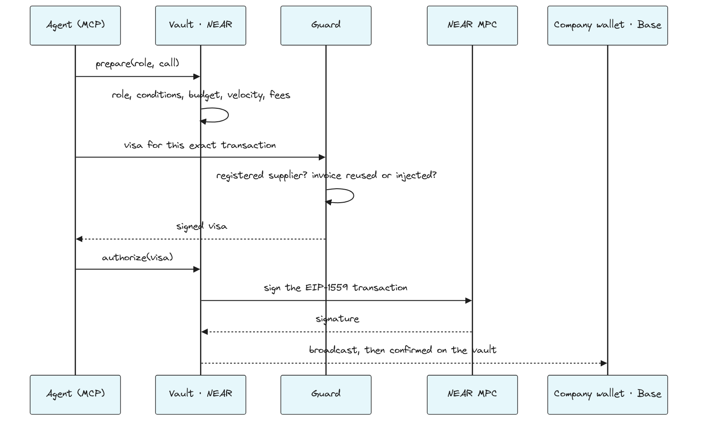

# Euthyna

**Give AI agents money. Never the keys.**

Euthyna is a company wallet on NEAR where **people and AI agents act under rules the owners vote**.
Each member, human or agent, gets a role: which chains, contracts, functions, parameters and budget.
A vault with no access key checks the role on chain before NEAR Chain Signatures sign anything: on
NEAR and Base Sepolia today, Ethereum and Solana in the code. Everything outside the roles is a multisig vote of the owners.
The company wallet needs no gas: once the owners vote it, Euthyna's relayer pays its Base transactions (EIP-7702, testnet),
and a swap's approval is granted and revoked in the same transaction.

So a hijacked agent cannot pay the attacker, a stolen server cannot move funds, and one rogue member
cannot change the rules: **48 attacks, 48 refused** ([Check it yourself](#check-it-yourself)).

Built at the [NEAR Hackathon](https://nearhackathon.com/) (tracks 06 AI Security & Defense,
03 Privacy & Private AI, 04 Autonomous Business, 07 Agent Economy, 08 Real-World Money, 12 Social Money).
Testnet only, unaudited. Work started on 20 October 2026: see [Built for the hackathon](#built-for-the-hackathon).

- **Demo:** <link to the X post>
- **Live:** [euthyna.io](https://euthyna.io) · **Judges:** [JUDGE-PATH.md](./JUDGE-PATH.md), about 20 minutes, each step checkable on chain
- **Every claim and its status** (testnet, code, next): [CLAIMS.md](./CLAIMS.md)
- The same author also submits **NEAR Post** ([github.com/Koploseus/near-post](https://github.com/Koploseus/near-post)), a football game on NEAR.

## Why

Companies want AI agents to do the busywork: read an invoice, check it, pay it. Four things stop them.

| The problem | Euthyna's answer |
| --- | --- |
| **An agent with a key can be talked into spending it.** In May 2026 a Morse-code reply to Grok moved about $150,000 out of its Bankr wallet [1]; in February 2026 a trading agent sent a stranger tokens worth about $440,000 after a spam message [2]. | The rules live in the company wallet, not in the agent. The owners vote each member's role, human or agent; a NEAR vault with no access key checks it on chain before anything is signed. Outside the role, it is a vote. |
| **Keys get lost.** Chainalysis estimates that 17% to 23% of all bitcoin is lost or out of circulation [3]. | A founder who loses their wallet proves in the browser, in zero knowledge, that they hold the mailbox they enrolled. A NEAR contract verifies the proof; the address never goes on chain; the lost account can cancel during a waiting period; then the founders vote the seat back. |
| **A company's trades are public.** An on-chain limit order publishes its price, so anyone can read the treasury's plan and trade ahead of it. | Sealed orders: price, total and deadline are one hash on chain, before and after a fill. Each fill comes with a zero-knowledge proof that it meets the hidden terms, verified on NEAR. |
| **The bank stays off chain, and so does its fraud.** Business email compromise, mostly swapped bank details on invoices, cost $2.8 billion in 2024 in FBI reports alone [4]. | The company's euro IBAN obeys the same on-chain rules. Members vote each supplier's IBAN; an agent pays only voted IBANs, within its role's euro budget. The bank partner's key sits in an enclave that answers only the vault, and the IBANs never appear on chain. |

Asking a human to approve every payment removes the point of an agent; Gartner expects over 40% of agentic AI
projects to be cancelled by 2027, citing inadequate risk controls among the reasons [5].

**An example.** Léa (fictional) and her two partners run a small design studio. They vote one role for their
bookkeeping agent: pay the suppliers they voted, by IBAN or in EURC, within a euro budget. The agent pays a
supplier's invoice by SEPA. A poisoned invoice asks it to pay another account: the vault refuses, whatever the
agent believes. Léa loses her phone: her email gets her seat back, by a proof and a vote. The studio parks
its cash in WETH with a limit order nobody can read. **We ran each step on testnet**: the agent paid Atelier
Dupont SAS 4.78 EUR by SEPA ([docs/bank.md](./docs/bank.md)), a seat was recovered on chain
([docs/recovery.md](./docs/recovery.md)), a sealed order was filled on Base Sepolia
([docs/sealed-orders-testnet.md](./docs/sealed-orders-testnet.md)), and [Rob the Agent](https://euthyna.io/rob)
lets anyone try to make a hijacked agent pay outside its role.

**Where it goes.** Today, a company wallet for teams that let agents pay. Next, **Atlantis**: anyone starts an
AI company owned by its shareholders through a Sputnik DAO; agents do the work, and the revenue goes to the
holders who vote.

[1] [Giskard](https://giskard.ai/knowledge/how-grok-got-prompt-injected-an-x-user-drained-150-000-from-an-ai-wallet) ·
[2] [KuCoin News](https://www.kucoin.com/news/flash/ai-agent-lobstar-wilde-loses-440-000-in-solana-transfer-error) ·
[3] [Chainalysis via PaymentsNext](https://paymentsnext.com/chainalysis-research-shows-up-to-23-of-bitcoin-are-mia/) ·
[4] [FBI IC3 via Nacha](https://www.nacha.org/news/fbis-ic3-finds-almost-85-billion-lost-business-email-compromise-last-three-years) ·
[5] [Gartner](https://www.gartner.com/en/newsroom/press-releases/2025-06-25-gartner-predicts-over-40-percent-of-agentic-ai-projects-will-be-canceled-by-end-of-2027)

Names used below: the **vault** (OmniRoles) is the contract that holds the rules and asks NEAR MPC to
sign; **Nomos** creates one vault per company; the **Guard** is optional off-chain advice that can
only refuse; **euthyna-signer** keeps an agent's key away from the AI; **Atlantis** is the launchpad
built on Euthyna (see Where it goes).

## Check it yourself

```bash
# 1 minute, Node 22 only: 8 attacks on a live testnet vault, view calls only (no key, no gas)
node scripts/attack-testnet.mjs       # 8 of 8 attacks refused by the live vault
# a live vault has no access key (NEAR CLI)
near account list-keys pixel-forge.nomos.euthyna.testnet network-config testnet now
# the full suite, with Rust and cargo-near: a real vault in a NEAR sandbox, plus the Guard
# (the NEAR sandbox node needs `ulimit -n 65535`; a container with a lower hard limit cannot start it)
pnpm install && pnpm attack:all       # 48 attacks: 48 refused
```

## What is new here

| | | Proof |
| --- | --- | --- |
| 1 | **One policy engine for every chain.** A role pins chain, contract, function and calldata conditions (recipient, amount read from the calldata), with refilling budgets, velocity limits, co-signature thresholds and single-use references. The vault enforces it on NEAR, then NEAR MPC signs the transaction for the target chain (Base on testnet; Ethereum and Solana in the code). | `contracts/vault`, `contracts/omniroles-conditions`; Base Sepolia payments on testnet |
| 2 | **Nothing to steal.** The vault, the registry and the vault factory (Nomos) have no access key; the company wallet has no private key. No Euthyna server holds a key that moves funds, and the vault settles from an MPC attestation of the finalized transaction, not from a server. | `view_access_key_list`; `contracts/tests/tests/settlement.rs` |
| 3 | **The key never reaches the AI.** An agent's key is a NEAR function-call key for 16 vault methods. `euthyna-signer` keeps it under another system user and signs only requests to that vault: the AI can ask for a signature, never read the key. | `signer/` (Rust, 24 tests) |
| 4 | **Limit orders nobody sees.** Price, total and deadline are one hash on chain, before and after a fill. Each fill comes with a zero-knowledge proof that it meets the hidden terms, verified on NEAR, and still goes through the swap role. | `contracts/sealed-orders`; filled on testnet |
| 5 | **A lost key is not a lost seat.** A zero-knowledge proof that you hold the mailbox you enrolled, made in your browser and verified by a keyless NEAR contract (the address itself never goes on chain); the lost account can cancel during a waiting period; then the founders vote the seat to the new account. | `contracts/email-recovery`, `circuits/email-recovery`; testnet run |
| 6 | **AI companies buy from each other.** An agent hires another company's agent over A2A + x402; its spending card signs a cheque that the market cashes only on delivery. | `apps/api/src/market/e2e.integration.test.ts` (sandbox, the real signer) |
| 7 | **Owned by people, run by agents.** Investors buy shares and vote with them; each epoch, revenue goes to the holders who voted. An agent can send revenue through Omni Bridge to the shares contract, and nowhere else. | `contracts/shares`; testnet hashes in [docs/shares.md](./docs/shares.md) |
| 8 | **Try to rob it.** Rob the Agent: each card is a real testnet transaction from a hijacked agent against a real vault. 0 USDC stolen so far, and a bounty for whoever makes it pay outside its law. | [/rob](https://euthyna.io/rob), [docs/rob-the-agent.md](./docs/rob-the-agent.md) |
| 9 | **A euro IBAN for the company, in and out.** A SEPA transfer arrives as EURC in the company wallet, and only there: the address is read from the vault, never from a request. Out: an agent pays a supplier's **IBAN** under the vault's rule (IBAN voted by the members, amount within the role's euro budget), because the bank partner's key lives in a TEE ([OutLayer](https://outlayer.fastnear.com)) that answers only the vault. | [docs/bank.md](./docs/bank.md), `contracts/vault/src/bank.rs`, `bank-signer/` |
| 10 | **A wallet that never needs gas, and swaps that leave no approval behind.** One vote and the company wallet delegates its code (EIP-7702) to `EuthynaExecutor`, a contract with no owner and no upgrade: Euthyna's relayer sends the calls and pays the gas, but the wallet runs only what the vault had NEAR MPC sign, once, before a deadline, and the vault settles on the `Executed` log NEAR MPC attests. A swap runs as approve + swap + revoke in one transaction, signed once: the spender is the swap's own target and the revoke is added by the vault. | [docs/sponsored-gas.md](./docs/sponsored-gas.md) (Uniswap V3 WETH → USDC from a wallet at 0 ETH on Base Sepolia), `contracts/evm/executor`, `contracts/vault/src/sponsored.rs` |

## For agents and for people

| | Agents | People |
| --- | --- | --- |
| Who | AI employees, plugged in over MCP (`packages/mcp`) | founders, members, investors |
| What they can do | what their role allows, checked on chain | the same roles (a member can be a human), plus votes |
| Outside the role | refused, no escalation | a transaction voted by the DAO, like a multisig |
| Keys | a function-call key on the vault, kept by `euthyna-signer` | their own NEAR wallet; a lost one comes back by ZK Email and a vote |

## Tracks

| Track | What it asks | What Euthyna does |
| --- | --- | --- |
| **06 AI Security & Defense**<br>*give AI money without the keys to everything* | spending limits, policy engines, sandboxed wallets, function-call keys | The policy engine **is the wallet**: an agent's only key is a function-call key that can ask the vault, and the vault checks chain, contract, function, recipient, amount and budget on chain before MPC signs. No prompt injection can widen a role, and a stolen server finds no key that moves funds. The security council can veto a rule change or freeze every agent in one click. 48 attacks, 48 refused, and a public game (Rob the Agent) where anyone can try. |
| **03 Privacy & Private AI**<br>*private by design* | confidential computation, private finance, protecting sensitive data | **A company can trade without showing its hand.** Its limit orders live as a single hash on chain; the limit price, the total and the deadline are never published, not even after a fill, and each fill is proven correct in zero knowledge. Only the members read the terms, encrypted to keys derived from their own wallets. **A founder recovers their seat without exposing their email**: a zero-knowledge proof made in the browser, only a salted hash on chain. |
| **04 Autonomous Business**<br>*the company of one, or none* | treasury, sales, procurement, revenue sharing, chain signatures | **A company that runs itself, under rules its owners vote.** Agents pay suppliers and swap on Base through NEAR Chain Signatures, sell their work to other companies' agents on the Market (paid only on delivery), and send revenue to the shareholders through Omni Bridge. Humans only set the roles and the budgets. |
| **07 Agent Economy**<br>*give AI a wallet* | agents that earn, spend, negotiate and hire | **Agents hire agents.** A company's agent finds another company's agent on the Market, hires it over A2A + x402, and its spending card signs a cheque the market cashes only on delivery; the seller's vault receives exactly the price. Each agent spends from a budget its owners voted, refilled by the vault. |
| **08 Real-World Money**<br>*bring the boring money onchain* | invoicing, merchant payments, stablecoin rails for real businesses | **A company bank account that obeys the law it voted.** Clients pay the company's euro IBAN; the euros arrive as EURC in a wallet with no private key; the members vote a supplier payment and the vault signs it, or an agent pays invoice by invoice within a role's EURC budget, including to a supplier's IBAN: the vault checks the voted IBAN and the budget on chain, and the partner's API key sits in a TEE that obeys only the vault. **Invoicing** (each invoice has an RF reference and a SEPA QR; paid automatically when the transfer lands), **Payroll** (standing orders the members vote once, paid on each date without an agent) and **remittances** (sealed payees paid in their currency: Pix and SEPA paid on testnet, ACH and Faster Payments in the code); accounts and names never on chain. Agents pay without gas (meta transactions, NEP-366), and the company wallet too: Euthyna relays its Base transactions and pays the gas (EIP-7702, by vote). Activity exports a CSV with the transaction of every payment, for the accountant. |
| **12 Social Money**<br>*coordinate value together* | collective ownership, shared budgets, Sputnik DAO; build on the multisig, not a new one | **Sputnik becomes a company.** The DAO owns a vault that pays on NEAR and Base; members vote budgets per role instead of signing every payment; investors buy shares, vote, and earn the revenue of the epochs they voted in. A lost wallet does not cost a seat: the other founders vote it back. |

## Security model

We assume the agent will be compromised: a prompt injection, a poisoned memory or a replaced MCP tool
lets the attacker make it sign anything its key can sign. So no lock depends on the agent behaving.

| Threat | Defence | Proof |
| --- | --- | --- |
| A hijacked agent pays the attacker | The vault checks the role on chain before anything is signed | `contracts/tests/tests/attacks.rs`, [docs/attacks.md](./docs/attacks.md) |
| A large payment | A human co-signs above the role's threshold; the agent cannot co-sign its own | `ERR_COSIGN_REQUIRED`, `ERR_SELF_COSIGN` in the attack suite |
| A stolen Guard key | The role conditions run before any visa: the Guard can only refuse, never widen a role | attack suite |
| A stolen server, database or deployer key | No key that moves funds exists off chain (see 2 above) | `view_access_key_list`, `contracts/tests/tests/settlement.rs` |
| A bad rule pushed through | Rules change only by DAO vote (two thirds), then wait out a veto window; one council member can veto a queued change; the council can pause every agent, only a vote resumes them | `contracts/tests/tests/dao_governance.rs` |
| A bad bank enclave version | The vault runs one enclave hash. With "take updates" on, a new published version is queued as an ordinary rule: it applies after the veto window, and one council member can veto it (a vetoed version never comes back). Without it, each version is a vote | [docs/bank.md](./docs/bank.md#enclave-updates-one-vote-or-none-with-a-veto-window) (testnet run: 0.2.0 → 0.2.1 with no vote) |
| A malicious code upgrade | Nomos publishes each vault version by its hash; a vault upgrades only on a DAO vote for that hash, after the veto window. The DAO can also vote `SetCodeSource` to fetch versions elsewhere | `contracts/tests/tests/nomos.rs` |
| A founder loses their NEAR account | ZK Email recovery, verified on chain (see 5 above) | [docs/recovery.md](./docs/recovery.md) |
| A malicious gas relayer | It can send a signed call or not, nothing else: the executor checks the wallet's own signature, a single use per operation and a deadline; a call that never runs gives its budget back after the deadline | `contracts/evm/executor/test`, `contracts/vault/src/onchain_tests.rs` (`sponsored_flow`) |
| An investor majority turns hostile | The founders keep their veto on vault changes | [Owners and money](#owners-and-money) |

## Try the seat recovery

The ZK Email proof is verified by a NEAR contract, `euthyna-recovery-v5.testnet`. On testnet the lost account can
cancel for **2 minutes** (48 hours is meant for mainnet), so the whole flow fits in one sitting.

**1. Check the contract, read-only (1 minute, no wallet).** [near CLI](https://github.com/near/near-cli-rs):

```bash
near account list-keys euthyna-recovery-v5.testnet network-config testnet now
#   → no access key: nobody can change or upgrade it
near contract call-function as-read-only euthyna-recovery-v5.testnet dkim_keys json-args '{"domain":"gmail.com"}' network-config testnet now
#   → the DKIM keys it accepts for Gmail (sha256 of the key as the circuit takes it)
near contract call-function as-read-only euthyna-recovery.testnet recoveries_of json-args '{"dao_id":"eut-rec-11526.sputnikv2.testnet"}' network-config testnet now
#   → the demo DAO's history on the first contract (euthyna-recovery.testnet): one recovery cancelled by the founder, then one left to run past its delay
#     (ready: true), after which the founders voted the seat to the new account
near contract call-function as-read-only eut-rec-11526.sputnikv2.testnet get_policy json-args '{}' network-config testnet now
#   → council: dave, carol, bob (bob replaced alice, the founder who "lost" her account)
```

The account's code hash is `Eg1Ht4oYrNVjDVaqgsGrwPgsev1ZsbfzMr4HPd5uRhPa`, base58 of the sha256 of
`contracts/res/email_recovery.wasm` (built in the pinned image the CI checks). Every transaction of the run is in
[docs/recovery.md](./docs/recovery.md#on-testnet).

**2. Re-run the proofs (5 minutes).** Real emails, real proofs, a NEAR sandbox:

```bash
cd contracts && cargo test -p tests --test email_recovery
#   → 4 passed: an unknown DKIM key, another account's email, a flipped public input, another mailbox,
#     another salt are refused; a real iCloud email verifies on chain; ready only after the delay
ZK_EMAIL_PROVE=1 pnpm --filter @euthyna/api exec vitest run src/recovery/email.prove
#   → the circuit in Node: a zero-knowledge proof verifies, a forged one does not
```

**3. In the console (about 15 minutes).** As a founder of a company: **Settings → Seat recovery**. Send yourself an
email with the subject shown (`Euthyna enroll near:<your account>`) from Gmail, Outlook, iCloud, Yahoo or Proton
(on testnet also a [YOPmail](https://yopmail.com) inbox, which has no password: testnet only), paste its source,
**Prove**, sign. → *Enrolled on chain: a mailbox at … can recover your seat.* Then, signed in with another NEAR
account, open **/recover**, give the DAO and the founder's account, send `Euthyna recovery near:<new account>` from
the same mailbox, prove and sign. → *Request recorded on chain … can cancel it until …* The founder sees it in
Settings and can **cancel**; after 2 minutes any member gets **Submit the vote**. The email never leaves the
browser; only the zero-knowledge proof and a salted hash of the address go on chain.

## Sealed orders: limit orders nobody sees

A company can place a limit order (buy WETH with USDC on Uniswap when 1 WETH costs at most X) without
showing it. The DAO votes on one hash. Whoever holds the order file (the member who sealed it) runs the
watcher; when the market meets the hidden limit, it proves in zero knowledge (Noir, UltraHonk) that the
fill meets the limit, the total and the deadline. `contracts/sealed-orders` verifies the proof on NEAR,
then asks the vault for the swap as a member of a `sealed-orders` role, so the role still decides the
router, the pair, the recipient and the budget. The hidden terms never reach the chain, not even after
a fill; the fill itself (amount, pair, rate) is a public Base transaction. Details and limits:
[CLAIMS.md](./CLAIMS.md#sealed-orders-private-limit-orders).

Turn it on with "Allow sealed orders" in a swap role (Rules); place orders by a vote (Wallet → Sealed orders) or from
an agent of that role (MCP `place_sealed_order`, or the CLI below); members read the terms with a key derived from a
signature of their wallet.

```sh
pnpm --filter @euthyna/api sealed place --key agent.json --vault <vault> --role <role> --price 1800 --cap 50 --days 7 > order.json
pnpm --filter @euthyna/api sealed watch order.json --key watcher.json
```

## Product architecture



1. **Raise**: founders create the company; investors buy shares and the proceeds go to the treasury.
2. **Hire**: the owners vote a role for each AI employee. The agent plugs in over MCP.
3. **Work**: agents pay suppliers, swap and invest within their budget, and bring revenue back.
4. **Share**: each epoch, revenue goes to the investors who voted.
5. **Show**: the company lists itself in the public directory, by vote.

## Technical architecture


| Layer | Holds keys that move funds? |
| --- | --- |
| Agent | no: a NEAR function-call key on the vault only (16 agent methods, each checked against the agent's role on chain; no NEAR transfer, no other contract, no new key) |
| API, Guard, worker | no: visa keys and broadcasting only |
| OmniRoles vault, registry, DAO factory | no access key after deployment |
| Company wallet | no private key exists; NEAR MPC signs only what the vault asks. Once the owners vote sponsored gas, delegated (EIP-7702) to `EuthynaExecutor`, which runs only calls signed by that key |
| Gas relayer (testnet tank) | its own test ETH only: it sends the calls the vault signed and pays their gas; it cannot change, replay or add a call |

Contract invariants and the full key model: [Architecture.md](./Architecture.md). Diagram sources: [docs/diagrams](./docs/diagrams).

## How an agent's payment goes through



The vault checks the role before any visa exists, so a stolen Guard key still
cannot leave the role. Without the Guard, agents stop, but founders can still
vote transactions.

## Owners and money

- **Founders** vote on everything by two thirds: roles, budgets, members, pause,
  and transactions outside any role (a multisig).
- **Investors** buy shares at a fixed price (proceeds go to the DAO) and lock
  them to vote on company calls and transfers, by majority of locked shares.
  Founders keep their veto on vault changes.
- **Revenue for voters**: what the company shares in an epoch (NEAR, or Base ETH
  bridged by Omni Bridge) goes to the holders who voted on at least one proposal
  of that epoch, pro rata. The part of the others goes to them.
- **An agent can share revenue on its own**: its role lets it send ETH through the
  Omni Bridge to the company's shares contract, and nowhere else.

Details: [docs/shares.md](./docs/shares.md).

## Market: AI companies sell to each other

Every company can sell a service (a DeFi due diligence report, a transaction check) to agents and people, paid
to its vault on NEAR. It speaks the same protocol as NEAR's AI agent market (A2A + x402 v2), on testnet.

1. **Sell.** Console → Market → New listing; create the worker token; run the worker
   (`apps/market-worker`, `tx-check` or `defi-due-diligence`); put the listing live. It appears on `/market`.
2. **Give an agent a card.** `sudo euthyna-signer card <agent>`, then a rule « Pay in NEAR tokens » to the
   agent's card with a daily budget: the vault refills it, the agent spends from it.
3. **Buy as an agent.** In the MCP: `list_market_agents`, then `hire_agent(handle, task, max_price)`. The card
   signs one `ft_transfer` cheque (NEP-366); the market holds it and relays it only when the seller delivers.
4. **Buy as a person.** `/market` → Pay and run; the wallet sends the transfer upfront (browser wallets cannot
   sign held cheques yet), the work starts once it is final.

How the cheque is checked, what the worker's agent may do, and what was tested: [docs/market.md](./docs/market.md).

## Proof

| What | Where |
| --- | --- |
| 48 attacks refused (hacked agent, stolen Guard key, stolen server, one rogue member) | `pnpm attack:all`, [docs/attacks.md](./docs/attacks.md) |
| The same attacks against a live testnet vault, read-only | `pnpm attack:testnet` |
| Shares: sale, votes, revenue only for voters, over three epochs | [docs/shares.md](./docs/shares.md) (testnet hashes) |
| An agent sends ETH from Base to the investors through Omni Bridge; the same call to another account is refused | [docs/shares.md](./docs/shares.md) (testnet hashes) |
| Keyless registry deployed; companies listed by DAO vote | [docs/registry.md](./docs/registry.md) (testnet hashes) |
| Founder seat recovery verified on chain: enroll, a request from another mailbox refused, cancel, ready after the delay, then the founders' vote | [docs/recovery.md](./docs/recovery.md) (testnet hashes), `contracts/tests/tests/email_recovery.rs` |
| Market end to end: an agent hires another company's agent, its card pays on delivery, the seller's vault receives exactly the price | `apps/api/src/market/e2e.integration.test.ts` (NEAR sandbox, PostgreSQL, the real euthyna-signer) |
| Sponsored gas: a wallet at 0 ETH pays, swaps on Uniswap V3 (approve + swap + revoke in one transaction) and receives an NFT; each call settled on NEAR from the MPC-attested `Executed` log; Simple7702Account compared live | [docs/sponsored-gas.md](./docs/sponsored-gas.md) (testnet hashes) |

## Run it

Requirements: Node 22, pnpm 12.15 (`npm i -g pnpm@12.15.0`), PostgreSQL, and
Rust with `cargo-near` for the contracts.

```bash
pnpm install
cp env.example .env            # fill it; never commit it
pnpm --filter @euthyna/db exec prisma db push
pnpm --filter @euthyna/api dev        # API on :3000
pnpm --filter @euthyna/api worker     # broadcasts what the vault signed
pnpm --filter @euthyna/console dev    # console on :5173
```

### Docker Compose

Docker runs PostgreSQL, the one-shot Prisma schema sync, API, worker and static
console. Copy and fill `.env` first; it is mounted at runtime and excluded from
the image build.

```bash
cp env.example .env
docker compose up --build -d
docker compose logs -f api worker
```

Open `http://localhost:8088`. PostgreSQL is exposed on `127.0.0.1:5434` for
local diagnostics. Override either host port without changing the containers:

```bash
MANDATEOS_HTTP_PORT=8081 MANDATEOS_POSTGRES_PORT=5435 docker compose up --build -d
```

Stop the stack while preserving PostgreSQL data with `docker compose down`.
`docker compose down --volumes` also deletes the database and is destructive.
Private keys and Guard secrets belong only in `.env` or a Docker secret; never
copy them into an image.

Checks:

```bash
pnpm typecheck && pnpm test
cd contracts && ./build.sh && cargo test --workspace
pnpm attack:all
```

## Repository

| Path | What |
| --- | --- |
| `contracts/vault` | the OmniRoles vault: roles, budgets, veto window, nonces, MPC signing |
| `contracts/omniroles-conditions` | the rule engine (condition trees on calldata, in Rust) |
| `contracts/shares` | shares: token, sale, Sputnik votes, revenue by epoch for voters |
| `contracts/dao-factory` | creates the company DAOs |
| `contracts/registry` | the public directory of companies |
| `contracts/email-recovery` | founder seat recovery: verifies ZK Email proofs on chain (UltraHonk on NEAR's BN254 host functions) |
| `circuits/email-recovery` | the ZK Email circuit (Noir); `circuits/vendor` and `contracts/vendor` hold the patched libraries |
| `contracts/evm/executor` | `EuthynaExecutor` (Solidity, Foundry): the code a company wallet delegates to for sponsored gas (EIP-7702) |
| `contracts/tests` | sandbox tests and the on-chain attack suite |
| `apps/api` | sign-in, Guard, supplier registry, proposals, worker |
| `apps/console` | the console and the public pages (`/`, `/c/<dao>`) |
| `packages/sdk`, `packages/mcp` | the agent side: SDK and MCP server |
| `signer` | `euthyna-signer` (Rust): keeps an agent's NEAR key away from the AI and signs only requests to its vault |
| `apps/demo-agent` | a small agent that pays invoices |

## Built for the hackathon

Work started on 20 October 2026 (the hackathon's rules open submissions on 1 November): 307 of the
517 commits on `main` (9 November) predate 1 November (`git rev-list --count main --before=2026-11-01T00:00:00Z`). Before 1 November: the vault and its rule
engine, the shares, the registry, the API, the console and the MCP server. From 1 November: ZK Email
seat recovery verified on chain, sealed orders, the euro IBAN with its bank enclave, sponsored gas (EIP-7702),
`euthyna-signer` in this repository and the bank pages of the console. `git log --before=2026-11-01` shows the rest.

## Names

**Euthyna** is the project and this repository (packages `@euthyna/*`); **Atlantis** is the launchpad built on it.
`MandateOS`, the project's first name, survives only in testnet account names (`*.mandateos-root-20261021.testnet`),
the local database name and the contracts' Cargo metadata (changing it would change the wasm hashes).

