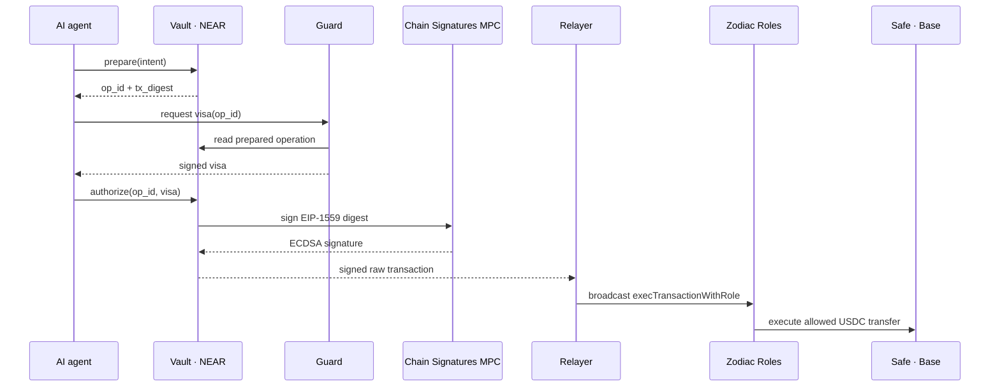

# MandateOS

**Let AI agents manage company funds inside mandates approved by humans, without giving an agent a treasury key.**

MandateOS assigns each agent a role, a budget, permitted assets, approved destinations and permitted operations. An agent can request an operation; it cannot sign an arbitrary treasury transaction. Every operation must pass three independent controls before funds move.

> Hackathon scope: NEAR Hackathon 2026, track 06 — AI Security & Defense.
>
> Project status: Phase 1 runs end to end on NEAR testnet + Base Sepolia: DAO-governed Vault, Guard visa, real MPC signature, Zodiac/Safe execution, 1 TestUSDC (token de test) payment and signed confirmation report. Phase 2 Intents and the production governance relay remain roadmap.

## Problem

AI agents can prepare invoices, rebalance assets and move funds across chains. Giving such an agent a wallet key makes its prompt, dependencies and runtime part of the treasury security boundary. A prompt injection, compromised dependency or leaked credential can then become an unrestricted signing capability.

MandateOS moves the limits outside the agent. The agent receives an API identity and a NEAR function-call key restricted to its client's Vault. The client generates that key locally. The agent never receives an EVM key. NEAR function-call keys can restrict a key to named methods on one receiver contract ([NEAR access keys][near-access-keys]).

## A mandate

The current Guard reads an explicit per-client JSON registry from `config/clients/<client>/vendors.json`. It contains exact addresses and amount ceilings; an absent case is escalated. The target control plane stores versioned drafts and immutable policy snapshots in PostgreSQL through Prisma, then compiles Guard, Vault and Zodiac artifacts from one approved snapshot.
An illustrative Phase 1 mandate contains:

| Field | Value |
|---|---|
| Client | ACME |
| Role | `researcher` |
| Agent | Better Auth client + NEAR function-call account |
| Operation | Base USDC payment |
| Vendors | ACME SAS, Data Provider |
| Maximum per transaction | 5,000 USDC |
| Monthly budget | 6,000 USDC |
| Idempotency | Contract-period or purchase-order reference |
| Gas | Governed `gasLimit`, `maxFeePerGas` and total fee |

The JSON registry is the reviewable hackathon input, not an on-chain authority. The Vault and Zodiac remain the sources of truth for active controls. The target multi-client service moves drafts and versions to PostgreSQL; the repository already contains the Prisma schema, while database-backed policy publication remains unimplemented.

## Three locks

| Lock | Location | Decision |
|---|---|---|
| **1. Guard** | TypeScript backend | Applies exact business rules to a prepared operation and signs a short-lived ed25519 visa bound to its exact transaction digest. An uncovered case is escalated to a human; it is never approved by inference. |
| **2. Vault** | Rust contract on NEAR, one per client | Enforces agent identity, role, budget, allowlist, reference idempotence, visa nonce and expiry. It builds the EIP-1559 transaction and requests an ECDSA signature from NEAR Chain Signatures. The Phase 1 builder is [`omni-transaction` 0.3][omni-transaction]. |
| **3. Zodiac Roles** | Roles Modifier attached to a Safe on Base | Restricts the target, function, calldata parameters and periodic allowance before the Safe executes the USDC transfer. Roles exposes `execTransactionWithRole` for this controlled execution path ([Roles repository][zodiac-roles]). |



The MPC address `0xAAA` is derived from `(Vault account, agent path)`. The Vault is the caller of the MPC contract, so only the Vault's code can request signatures for that derived address. Chain Signatures derives foreign-chain accounts from the NEAR caller and a derivation path ([Chain Signatures documentation][chain-signatures], [MPC repository][near-mpc]).

## Implemented

The current repository contains:

- `contracts/vault`: `prepare`, domain-separated Guard visas, EIP-1559 construction, `PossiblySigned`, nonce cancellation and signed confirmation reports;
- `contracts/mock-mpc` and `contracts/test-ft`: sandbox dependencies, including delayed MPC response simulation;
- `contracts/tests`: nine DAO tests and seven Vault tests using NEAR Sandbox;
- `apps/api`: Hono Guard and Base relayer, exact JSON registry evaluation, viem digest recomputation, ed25519 visas and confirmation reports;
- `packages/deployer`: guarded viem deployment script for Safe 1.4.1, Roles 2.1.1 and Delay 1.1.1, plus a tested USDC permission compiler;
- `packages/db`: validated Prisma schema for clients, environments, agents, vendors, policy snapshots and operations;
- [`docs/dao-spike.md`](./docs/dao-spike.md): DAO policy, source citations and factory verification;
- [`docs/vault-testnet.md`](./docs/vault-testnet.md): Vault protocol, test coverage and testnet deployment evidence;
- [`deployments/near-testnet.json`](./deployments/near-testnet.json): machine-readable deployed accounts and measured MPC gas.

Guard and Roles policy behavior run locally. NEP-366 sponsorship, governance relay, console, SDK, Base contracts and Base broadcast are not implemented or deployed unless an address and transaction hash appear in the deployment manifests.

## Architecture target

### Phase 1 — Base USDC payment

Phase 1 is complete only when this path runs end to end:

1. an authenticated agent calls `prepare(intent)` on its client's Vault;
2. the Vault reserves the role budget and business reference, assigns `op_id` and the next EVM nonce, builds the canonical EIP-1559 transaction and exposes `tx_digest`;
3. Guard reads that prepared operation, applies exact registry and policy rules, and signs the Borsh-encoded visa;
4. the agent calls `authorize(op_id, visa)`;
5. before calling the MPC, the Vault consumes the visa, enters `PossiblySigned` and permanently advances the EVM nonce; callback failure or timeout never releases the reservation;
6. a relayer broadcasts the signed transaction without modifying it, or signs a higher-fee zero-value cancellation at the same nonce after a circuit breaker;
7. Zodiac validates the USDC target, `transfer` function, recipient and allowance before the Safe executes it.

Local development uses NEAR Sandbox. UAT uses **NEAR testnet as the control plane and Base Sepolia as the execution plane**, with test assets and a 5 USDC allowance. Production remains NEAR mainnet + Base mainnet after the UAT and negative tests pass ([NEAR networks][near-networks], [Base networks][base-networks]).

Each derived Base address holds a small ETH balance funded by an approved governance action. `maxFeePerGas`, `maxPriorityFeePerGas` and `gasLimit` are part of the signed EIP-1559 transaction and therefore of `tx_digest`; the Vault also enforces `maxFeePerGas × gasLimit` against the role's fee cap. `omni-transaction` exposes the EVM signing preimage and signed transaction assembly ([omni-transaction][omni-transaction]).

### Phase 2 — swap and bridge through NEAR Intents

Phase 2 is a stretch target, not an implemented feature. The Vault derives a dedicated Intents account `0xINT` and signs ERC-191 payloads through the MPC. The Intents verifier supports ERC-191 payload recovery and `0x…` implicit account IDs ([ERC-191 implementation][intents-erc191], [public-key implementation][intents-public-key]).

- **Deposit:** the Safe may transfer Base USDC only to the POA deposit address associated with `0xINT` and returned by `deposit_address` for chain `eth:8453` ([deposit example][intents-deposit-example]).
- **Swap:** Guard provides a reference price; the Vault accepts a quote only when the minimum received satisfies that reference, then signs and publishes the intent.
- **Bridge:** the Vault signs an `ft_withdraw` intent only for a wallet registered to the client.

Funds credited to `0xINT` are protected by the Vault but no longer by Zodiac. The design therefore keeps at most one period's Intents budget in that account.

## Roadmap

- member voting accounts restricted to on-chain votes and backed by passkeys;
- multi-client deployment factory, after the single-client ACME deployment script is stable;
- additional assets and chains;
- on-chain or independently verified Base receipt proofs instead of a Guard-signed confirmation report;
- audited replacement or audit coverage for the transaction-building dependency before production use.

The console itself uses Better Auth passkeys for login, prepares proposals and displays state. It never signs an on-chain proposal or treasury transaction ([Better Auth passkey plugin][better-auth-passkey]).

## Governance

The UAT governance path follows the Zodiac Key Challenge pattern:

1. at least three company members use standard NEAR wallets to vote in Trezu with explicit weight `2`;
2. the approved proposal calls the per-client NEAR relay;
3. Chain Signatures signs a Delay call for `0xGOV`;
4. `0xGOV`, directly or through an administrative Roles modifier, queues the change in Delay for 24 hours;
5. after the cooldown, Delay forwards the change through the Safe to the operational Roles modifier.

`0xGOV` is not a Safe owner. The Safe owners are a human security council using three hardware keys with threshold 2/3. The Safe owns Roles and Delay; the council can veto queued changes with `setTxNonce` and retains direct emergency authority. Agent payments use `0xAAA → Roles → Safe` without Delay. See [`Architecture.md`](./Architecture.md#gouvernance).

## Non-custodial properties

- MandateOS services do not hold an EVM private key for an agent, `0xAAA`, `0xINT` or `0xGOV`.
- The Guard key can approve only a prepared operation; it cannot call the Safe or force the Vault to request a signature.
- The Vault account has no access key after deployment. Policy changes and contract upgrades require the configured Trezu governance path.
- The relayer receives a complete signed transaction and only broadcasts it.
- A signature is treated as public from the moment the MPC request is made. `PossiblySigned` therefore keeps budget, reference and nonce locked through callback failure, timeout, pause and revocation.
- A compromised agent remains subject to Guard, Vault and Zodiac limits.
- A compromised Guard remains subject to Vault and Zodiac limits.

The DAO and Vault properties are exercised by automated tests. Safe/Zodiac and the complete payment path remain architecture claims until `deployments/base-sepolia.json` contains observed addresses and transaction hashes.

## Threat model

| Scenario | Required result | Bound |
|---|---|---|
| Agent calls `authorize` without a visa | Vault rejects | No payment |
| Visa is changed, expired or replayed | Vault rejects signature, digest, expiry or nonce | No payment |
| MPC response is late or its callback fails | Operation remains `PossiblySigned`; nonce cannot be reused | Denial of service until same-nonce cancellation |
| Vault is paused or agent is revoked after `sign` | Reservation remains; emergency worker requests `cancel_nonce` | No automatic reopening |
| Agent requests an MPC signature directly | Derived address differs from the role member | Zodiac rejects |
| Prompt injection changes the recipient | Guard registry check, Vault allowlist and Zodiac parameter condition reject | No payment |
| Invoice reference is submitted twice | Active reservation or consumed reference rejects it | No duplicate payment |
| Guard signing key is compromised | Vault budget and Zodiac allowance still apply | Role budget/allowance |
| Vault is compromised | Zodiac still restricts Base calls | Sum of funded role allowances until intervention |
| Common policy is wrong | All three compiled targets can accept the same error | Human-approved erroneous budget |
| Phase 2 `0xINT` path is compromised | Zodiac is no longer in that path | Balance held by `0xINT` |

The detailed assumptions and state transitions are in [`Architecture.md`](./Architecture.md#modèle-de-menace).

## Repository layout

Current monorepo layout:

```text
MandateOS/
├── apps/
│   └── api/                   # Hono Guard, Base relayer and emergency cancellation endpoint
├── config/
│   └── clients/acme/          # Exact hackathon vendor registry
├── contracts/
│   ├── vault/
│   ├── mock-mpc/
│   ├── test-ft/
│   ├── tests/
│   └── res/
├── packages/
│   ├── db/                    # Prisma schema and shared client
│   └── deployer/              # viem Safe/Roles/Delay deployment
├── docs/
│   ├── dao-spike.md
│   └── vault-testnet.md
├── deployments/
│   ├── base-sepolia.json
│   └── near-testnet.json
├── Architecture.md
├── pnpm-workspace.yaml
└── README.md
```

Still-targeted packages are `auth`, `agent-wallet`, `protocol`, `policy`, `sdk` and `cli`; the governance relay and console are also roadmap work. The API uses [Hono][hono]. [Prisma][prisma] defines the future PostgreSQL source of truth. MandateOS is independent and does not import or copy JOIN code.

## Getting started

Run all local checks:

```bash
pnpm install
pnpm typecheck
pnpm test
cd contracts
./build.sh
cargo test -p tests -- --nocapture
```

`build.sh` rebuilds the Vault and its two local test dependencies with the NEAR-compatible Rust 1.86 toolchain. The contract suite deploys Sputnik DAO and the Vault, removes their access keys and exercises DAO-only governance, visa checks, `PossiblySigned`, reservations, cancellation, EIP-1559 construction and delayed MPC responses. The TypeScript suite covers exact Guard escalation, domain-separated visas and the compiled Roles recipient/allowance conditions.

Run the local API only after filling a non-committed `.env` from [`env.example`](./env.example):

```bash
set -a
source .env
set +a
pnpm --filter @mandateos/api dev
```

The Base Sepolia script performs no transaction unless every required variable is present and `BASE_DEPLOY_CONFIRM=DEPLOY_ACME_BASE_SEPOLIA`. On success it writes observed addresses, code hashes and transaction hashes to `deployments/base-sepolia.json`:

```bash
pnpm --filter @mandateos/deployer deploy:base-sepolia
```

## Demo acceptance scenario

The three-minute demonstration is considered valid only with public explorer links:

1. show the approved ACME role, budget, registry entry and corresponding Zodiac permission;
2. pay the monthly ACME invoice in TestUSDC (token de test) from the Safe;
3. pay a separate approved purchase order;
4. submit an invoice with a different recipient and show the human escalation without payment;
5. resubmit the monthly invoice and show the idempotence rejection;
6. call `authorize` without a visa, then replay a consumed visa, and show both rejections;
7. sign through a different MPC caller/path and show Zodiac rejecting the resulting address.

## Deployments

The current UAT uses the security-corrected Vault and Base Sepolia chain ID `84532`. The older testnet deployment remains listed only under `superseded_deployment` in the machine-readable manifest.

| Component | NEAR testnet | Base Sepolia UAT |
|---|---|---|
| ACME DAO | `mandateos-uat-92543787.sputnikv2.testnet` | — |
| ACME Vault | `vault-v4.mandateos-root-20261021.testnet` | — |
| Test FT | `test-ft-v4.mandateos-root-20261021.testnet` | — |
| Agent | `agent-v4.mandateos-root-20261021.testnet` | `0x10EdE0F3C618321919934Fd63df173DD37F037Af` |
| MPC signer | `v1.signer-prod.testnet` | — |
| Safe 1.4.1 | — | `0x19C06E5bfCd7C31c71508f14df2f1C70d9D199cD` |
| Operational Roles 2.1.1 | — | `0x7178555779097cAE1BA20C5D7ED7205708a5ed40` |
| TestUSDC (token de test) | — | `0x418A2b47911dE05e21688F7490195F5324B49474` |
| Delay 1.1.1 | — | `0xDd860F2a45b62b84A94ABF61F7f6c2f262549533` |
| Temporary `0xGOV` module | — | `0x7e4FBed7A7B20A5671095DFBEb6B8A034934EAa6` |
| Researcher `0xAAA` | — | `0x10EdE0F3C618321919934Fd63df173DD37F037Af` |

Observed NEAR state is recorded in [`deployments/near-testnet.json`](./deployments/near-testnet.json). Base Sepolia addresses, bytecode hashes, council policy and transaction hashes are recorded in [`deployments/base-sepolia.json`](./deployments/base-sepolia.json).

On-chain verification observed Safe owners `3`, threshold `2`, both modules enabled, Delay `86 400 / 604 800`, an initial Safe balance of `5 TestUSDC (token de test)`, funded gas for `0xAAA`, a confirmed 1 TestUSDC (token de test) payment, a successful allowlisted permission simulation, and a `ConditionViolation` for an unregistered recipient.

## Limits

- The contracts and backend have not been audited. Testnet uses deterministic Guard credentials and placeholder EVM addresses.
- An MPC signature is considered public as soon as `sign` is called. Callback failure, timeout, pause or revocation does not release a `PossiblySigned` reservation; a confirmed same-nonce cancellation is required.
- The Vault depends on NEAR Chain Signatures availability. Testnet uses `v1.signer-prod.testnet`; production targets `v1.signer` ([MPC repository][near-mpc]).
- `omni-transaction` 0.3 builds the EIP-1559 preimage and does not publish an audit report in its repository ([omni-transaction][omni-transaction]).
- Agent-side NEAR gas sponsorship through NEP-366 is designed but not yet implemented; testnet smoke accounts are faucet-funded ([NEAR meta-transactions][near-meta-transactions]).
- Phase 1 is confirmed end to end. The payment transaction is `0x0bf66f0c192ee3874d8f69af9fc704d0abd616f8162390521fbaed088d8e4ea4`; the Vault state is `Confirmed`, with `1_000_000` spent and no reservation.
- Phase 1 Base Sepolia utilise `TestUSDC (token de test)`, un ERC-20 à 6 décimales déployé par le script UAT. Il ne s'agit pas de l'USDC Circle et il n'a aucune valeur.
- Le `0xGOV` Base Sepolia est un EOA temporaire activé uniquement pour vérifier le wiring Delay ; le relais Trezu → MPC n'est pas encore déployé et cette adresse n'est pas utilisée.
- A Guard-signed status report can only confirm the exact original transaction. Only the DAO owner can confirm an on-chain cancellation.
- A reverted transaction is never reopened automatically; DAO governance is required.
- The Safe security council retains full 2/3 emergency authority; operational policy limits it to veto and incidents.
- The common mandate is a common-mode risk: a policy error can be compiled into all three locks.
- Phase 2 assets held by `0xINT` are outside Zodiac protection; exposure is limited operationally to the period budget.
- The Base withdrawal memo and independent reference-price source remain open design points.

## License

[MIT](./LICENSE), copyright 2026 JOIN.

## Sources

- [NEAR access keys][near-access-keys]
- [NEAR Chain Signatures][chain-signatures] and the [MPC implementation][near-mpc]
- [`omni-transaction` 0.3][omni-transaction]
- [Zodiac Roles Modifier][zodiac-roles]
- [Safe signature encoding][safe-signatures]
- [Sputnik DAO v2][sputnik]
- [NEAR Intents contracts][near-intents]

[near-access-keys]: https://docs.near.org/protocol/accounts-contracts/access-keys
[chain-signatures]: https://docs.near.org/chain-abstraction/chain-signatures
[near-mpc]: https://github.com/near/mpc/blob/main/README.md
[omni-transaction]: https://github.com/near/omni-transaction-rs
[zodiac-roles]: https://github.com/gnosisguild/zodiac-modifier-roles
[safe-signatures]: https://github.com/safe-global/safe-smart-account/blob/main/docs/signatures.md
[sputnik]: https://github.com/near-daos/sputnik-dao-contract
[near-intents]: https://github.com/near/intents
[intents-erc191]: https://github.com/near/intents/blob/main/contracts/defuse/core/src/payload/erc191.rs
[intents-public-key]: https://github.com/near/intents/blob/main/contracts/defuse/core/src/public_key.rs
[intents-deposit-example]: https://github.com/near-examples/near-intents-examples/blob/main/verifier-examples/get-token-deposit-address.ts
[near-networks]: https://docs.near.org/protocol/network/networks
[base-networks]: https://docs.base.org/base-chain/network-information
[better-auth-passkey]: https://www.better-auth.com/docs/plugins/passkey
[hono]: https://hono.dev/docs/
[prisma]: https://www.prisma.io/docs/orm
[near-meta-transactions]: https://docs.near.org/protocol/transactions/meta-tx
