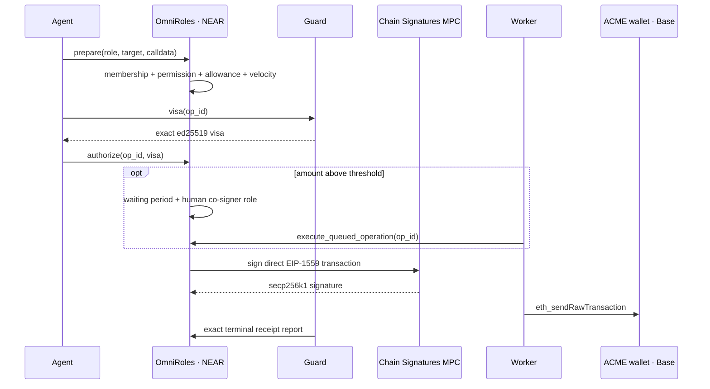

# MandateOS

**Let AI agents use company funds inside rules approved by humans, without giving an agent a treasury key.**

MandateOS is a NEAR control plane for chain-agnostic company wallets. **OmniRoles**, a keyless Rust contract on NEAR, owns one MPC-derived company wallet per chain and enforces role memberships, call permissions, shared allowances, waiting periods, co-signatures, velocity limits, nonces, and targeted vetoes. The demo chain is Base Sepolia ([architecture](./Architecture.md), [issue #40](https://github.com/joindefi/MandateOS/issues/40)).

## Current status

| Block | Status |
|---|---|
| Invitation security and founder console, PR #36 | Implemented; awaiting user validation before merge |
| OmniRoles task 1a | Implemented on `feat/omniroles-vault`; under test/UAT |
| `contracts/omniroles-conditions` task 1b | Parallel work owned separately; this branch does not touch it |
| Console OmniRoles cutover, issue #40 task 2 | Next PR after task 1a review |
| Paymaster, issue #39 | Later |

Safe, Zodiac Roles, Zodiac Delay, the Base governance relay, `0xAAA`, and `0xGOV` are **not** part of the target architecture. Legacy console/deployment files remain only until issue #40 task 2 replaces that UI; they are not evidence of an OmniRoles deployment.

## Why

Giving an AI agent an EVM key makes its prompt, runtime, and dependencies part of the treasury security boundary. MandateOS instead gives the agent:

- a Better Auth API identity;
- a NEAR function-call key limited to `prepare`, `authorize`, `cancel_nonce`, and `renounce_role` on one OmniRoles vault;
- no EVM private key.

The company wallet is derived by NEAR Chain Signatures from the vault account and a chain path such as `omniroles/evm/84532`. Only the vault code can request its signatures ([NEAR Chain Signatures](https://docs.near.org/chain-abstraction/chain-signatures), [`contracts/vault`](./contracts/vault)).

## Payment flow



The transaction directly calls the permitted target. For the Base Sepolia payment demo it is canonical `TestUSDC.transfer(recipient, amount)` calldata; no Safe/module wrapper exists.

## OmniRoles controls

### Roles and memberships

Agents and humans are both NEAR `AccountId` members. Memberships support:

- start and end timestamps;
- maximum use count;
- reservation while an operation is active;
- administrative revocation through a delayed rule change;
- immediate self-renouncement.

### Permissions

Each permission binds:

```text
chain_id + target + optional selector + condition bytes + optional allowance key
```

Empty condition bytes mean unconditional. Non-empty condition trees fail closed until the separate `contracts/omniroles-conditions` crate is wired through:

```rust
evaluate(conditions, calldata, context)
```

Task 1a supports arbitrary unconditional calls, canonical ERC-20 transfer allowance binding, and native ETH value binding. It never silently accepts an unsupported allowance-bearing call ([`conditions.rs`](./contracts/vault/src/conditions.rs), [`evm.rs`](./contracts/vault/src/evm.rs)).

### Shared allowances

Allowances are global to the vault, not to one chain:

- `balance`;
- `refill`;
- `max_refill`;
- `period_ns`;
- `timestamp_ns`;
- `reserved`.

Complete elapsed periods refill the balance up to `max_refill`. A prepared operation reserves allowance; confirmation consumes it; veto, failure, expiry, or cancellation releases it.

### Waiting periods and veto

Every rule change is queued on NEAR. The DAO can queue; anyone can execute after the waiting period; one stored council account can veto one exact queue entry. A council member may pause immediately; only the DAO can unpause.

Operations above a role threshold are also queued before MPC signing. This matters: a veto happens before a raw, broadcastable EVM transaction exists. Vetoing one operation does not advance or clear another chain wallet's queue.

### Co-signature and velocity

A distinct active **human** member of the role named by `co_signer_role` must call `co_sign` above the configured threshold. An agent or a member of the operation role cannot approve its peer's operation. Velocity accounting reserves risk value during preparation and charges it only after confirmed execution.

### Nonces and gas

Each chain wallet has one nonce and one active operation. The nonce advances only when OmniRoles commits to MPC signing. A vetoed pre-signature operation does not consume it. Once signing may have succeeded, cancellation uses the same nonce and a higher fee.

Until issue #39 provides a paymaster, the derived wallet holds a small ETH balance. The API estimates the direct token call from that wallet, refuses insufficient balance, and the vault caps `gas_limit`, `max_fee_per_gas`, `max_priority_fee_per_gas`, and total fee.

## Human governance

Sputnik/Trezu remains the human governance layer. A final vote calls `queue_rule_change`; it does not immediately mutate policy. OmniRoles itself enforces the waiting period and targeted council veto. Sandbox tests cover DAO authorization, delayed execution, direct-account rejection, and independent veto entries ([`dao_governance.rs`](./contracts/tests/tests/dao_governance.rs)).

## Repository

| Path | Responsibility |
|---|---|
| `contracts/vault` | OmniRoles policy state, queues, direct EVM transaction construction, MPC signing |
| `contracts/tests/tests/vault_operations.rs` | Membership, allowance, queue, veto, co-signature, velocity, nonce, visa and failure tests |
| `contracts/tests/tests/dao_governance.rs` | Sputnik-owned delayed rule changes |
| `contracts/tests/examples/deploy_omniroles_testnet.rs` | Real NEAR testnet → Base Sepolia payment runner |
| `apps/api` | Authentication, Guard, registry, gas estimation, payment worker |
| `packages/sdk` | Agent key store and direct ERC-20 OmniRoles request encoding |
| `packages/mcp` | Claude/MCP tools over the SDK |
| `packages/deployer/src/fund-omniroles-wallet.ts` | Funds the derived UAT wallet with ETH and TestUSDC |
| `packages/db` | Better Auth, organizations, members, agents, operations and audit rows |
| `apps/console` | PR #36 visual base; OmniRoles flow arrives in task 2 |

## Local verification

```bash
pnpm install
pnpm typecheck
pnpm test
pnpm build

cd contracts
./build.sh
cargo test --workspace
```

The Vault reproducible-build metadata is in [`contracts/vault/Cargo.toml`](./contracts/vault/Cargo.toml). Sandbox tests use the built artifact in `contracts/res/vault.wasm`.

## Base Sepolia UAT

Required secrets stay in local environment files and must never be printed or passed as CLI arguments. The payment runner reads them from the environment.

1. Deploy/configure OmniRoles and wait for the derived wallet:

```bash
cargo run -p tests --example deploy_omniroles_testnet
```

2. When it prints `OMNIROLES_WALLET_READY`, fund that public address in another terminal:

```bash
pnpm --filter @mandateos/deployer fund:omniroles
```

3. The runner waits for `OMNIROLES_MIN_GAS_WEI` and the requested TestUSDC amount, then prepares, authorizes, broadcasts, confirms, and reports the payment. It prints one `OMNIROLES_BASE_PAYMENT` JSON object containing every NEAR and Base transaction hash.

Observed jury UAT using the exact artifact in [`deployments/omniroles-base-sepolia.json`](./deployments/omniroles-base-sepolia.json):

- Sputnik owner: [`omni-92860380.factory-v2.mandateos.testnet`](https://testnet.nearblocks.io/address/omni-92860380.factory-v2.mandateos.testnet), with a distinct three-account council and threshold 2;
- keyless Vault: [`omni-vault-92860380…testnet`](https://testnet.nearblocks.io/address/omni-vault-92860380.dev-20261024164616-35109844835097.testnet), `rule_delay_ns = 300_000_000_000`, zero access keys, deployed code hash equal to the repository artifact;
- derived wallet: [`0x8cb6…aB81`](https://sepolia.basescan.org/address/0x8cb6e51ee112e848fc24d76030a54a160f1bab81);
- payment: [`0x2318…bd2d`](https://sepolia.basescan.org/tx/0x23183aac4f3744879dce974b2636e7fdce84781b64ad58bcf3ab4cae1fe9bd2d), a direct `TestUSDC.transfer` of `1.000000` token;
- terminal `Confirmed` report: [`CUMv…NniY`](https://testnet.nearblocks.io/txns/CUMv4QHQwU2tr3GVJr3TRLtmrtRonQGPGvBaxxhXNniY).

See [`.env.example`](./.env.example) for variable names. Never use faucet rotation or IP rotation.

## Security boundaries

- The server has no MPC or EVM fund-moving key.
- Guard uses separate ed25519 keys for business visas and terminal reports. Each key rotates only through a delayed rule change; neither can construct an MPC signature.
- Worker broadcasts exact raw bytes already signed by MPC.
- Unknown condition trees and unknown allowance-bearing calldata fail closed.
- Rule/allowance replacement is blocked while reservations are active.
- Failed Base transactions consume the wallet nonce but release policy spend through a signed `Failed` report.
- Contracts are unaudited and testnet-only.
- Wallet proof does not prove that invited accounts belong to distinct humans; PR #36 documents this limitation.

## Authentication

Humans sign in with their NEAR wallet (NEP-413 message, through a Better Auth plugin in `apps/api/src/near-auth.ts`). The server checks the signature, the one-time nonce, and that the signing key is a full-access key of the account on chain. A console user *is* a NEAR account.

Company members are the NEAR accounts the founder enters before the treasury exists (each account is checked on chain). No email is sent: a member signs in with that wallet and lands on their seat. They become the DAO members when the treasury is created; from then on the DAO policy is the source of truth.

What a member votes on is decoded in the browser from the proposal stored in the DAO, with full addresses next to supplier names. Sputnik only accepts a vote that repeats that exact proposal, so a server that showed something else could not collect votes for it. Before a role proposal is signed, the browser recompiles the role and refuses to sign if the server-prepared proposal differs.

Email/password is disabled. Browser-generated private keys exist only behind explicit UAT demo mode.

## License note

OmniRoles reimplements the required Roles v3 semantics in Rust. It does not copy BUSL-licensed Zodiac contract code. The condition-tree wire format is kept compatible where practical so the independently developed condition crate can interoperate with existing authoring tools.
