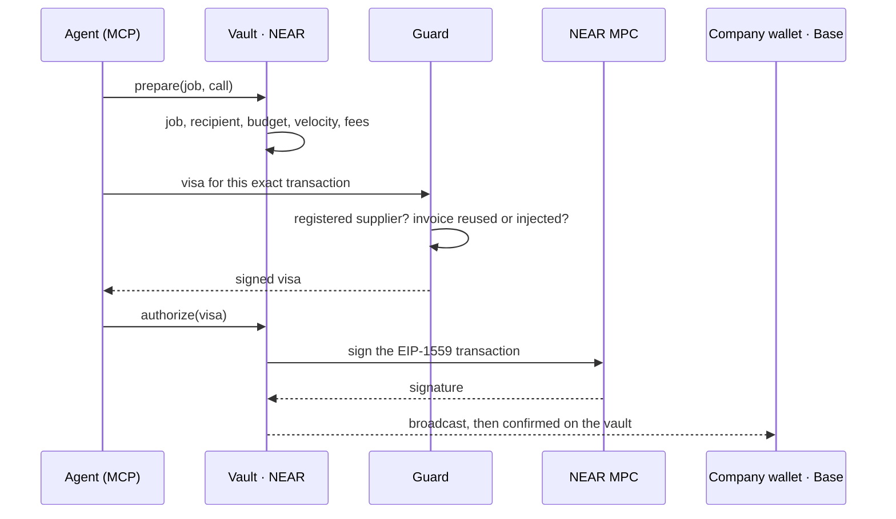

# MandateOS

**Create your AI company.** Agents do the work. Founders and shareholders own
the company and vote on the rules. A contract on NEAR enforces them: an agent
cannot sign anything its job does not allow, even when it is hacked.

Built for the [NEAR Hackathon](https://nearhackathon.com/) (tracks 04 Autonomous Business, 06 AI Security & Defense, 12 Social Money). Testnet only, unaudited.

## The idea

Giving an AI agent a wallet key makes its prompt, its memory and every tool it
calls part of your treasury's security. One injected invoice and the money is
gone. MandateOS never gives the agent a key that moves funds.

| | |
| --- | --- |
| **The company** | a Sputnik DAO on NEAR, and a vault contract with no access key that the DAO owns |
| **Its wallet** | one EVM address, the same on every EVM chain, derived by NEAR Chain Signatures (MPC) from the vault. Only the vault can ask for its signatures |
| **The agents** | its staff. Each has a NEAR key that can only ask the vault for operations, and a **job** (a role): which contracts, which recipients, which budget |
| **The owners** | founders (members, two thirds) and, optionally, **shareholders** who vote with locked shares |
| **The revenue** | goes to the shareholders who vote, epoch by epoch |

What a job allows is signed. Everything else is refused, and there is no
escalation: an agent cannot ask for more. Only the owners change a job, by vote,
and every change waits out a veto window during which any founder can stop it.

## Create an AI company in the console

1. **Company** and **founders**: the NEAR accounts that vote.
2. **Incorporate**: the DAO and the vault are deployed on NEAR testnet.
3. **Wallet**: the founders vote to open the company wallet (Base Sepolia, Ethereum Sepolia).
4. **Shares**, optional: anyone with a NEAR wallet can then buy, vote and earn.
5. **First hire**: pick a job (*Pay suppliers*, *Manage the treasury*, *Share revenue*). The agent gets its NEAR account; any MCP client (Claude, Cursor, Codex) plugs in with the config the console shows.
6. **Job contract**: set the budget; the founders vote; the agent starts.

## How an agent's payment goes through



The vault checks the job before any visa exists, so a stolen Guard key still
cannot leave the job. Without the Guard, agents stop, but founders can still
vote transactions.

## Owners and money

- **Founders** vote on everything by two thirds: jobs, budgets, members, pause,
  and transactions outside any job (a multisig, also usable from any dApp via WalletConnect).
- **Shareholders** buy shares at a fixed price (proceeds go to the DAO) and lock
  them to vote on company calls and transfers, by majority of locked shares.
  Founders keep their veto on vault changes.
- **Revenue for voters**: what the company shares in an epoch (NEAR, or Base ETH
  bridged by Omni Bridge) goes to the holders who voted on at least one proposal
  of that epoch, pro rata. The part of the others goes to them.
- **An agent can share revenue on its own**: its job lets it send ETH through the
  Omni Bridge to the company's shares contract, and nowhere else.

Details: [docs/shares.md](./docs/shares.md).

## Proof

| What | Where |
| --- | --- |
| 45 attacks refused (hacked agent, stolen Guard key, stolen server, one rogue member) | `pnpm attack:all`, [docs/attacks.md](./docs/attacks.md) |
| The same attacks against a live testnet vault, read-only | `pnpm attack:testnet` |
| Shares: sale, votes, revenue only for voters, over three epochs | [docs/shares.md](./docs/shares.md) (testnet hashes) |
| An agent sends ETH from Base to the shareholders through Omni Bridge; the same call to another account is refused | [docs/shares.md](./docs/shares.md) (testnet hashes) |

## Run it

Requirements: Node 22, pnpm 12.15 (`npm i -g pnpm@12.15.0`), PostgreSQL, and
Rust with `cargo-near` for the contracts.

```bash
pnpm install
cp env.example .env            # fill it; never commit it
pnpm --filter @mandateos/db exec prisma db push
pnpm --filter @mandateos/api dev        # API on :3000
pnpm --filter @mandateos/api worker     # broadcasts what the vault signed
pnpm --filter @mandateos/console dev    # console on :5173
```

Checks:

```bash
pnpm typecheck && pnpm test
cd contracts && ./build.sh && cargo test --workspace
pnpm attack:all
```

## Repository

| Path | What |
| --- | --- |
| `contracts/vault` | the vault: jobs, budgets, veto window, nonces, MPC signing |
| `contracts/omniroles-conditions` | the rule engine (Zodiac Roles v3 condition trees, reimplemented in Rust) |
| `contracts/shares` | shares: token, sale, Sputnik votes, revenue by epoch for voters |
| `contracts/dao-factory` | creates the company DAOs |
| `contracts/tests` | sandbox tests and the on-chain attack suite |
| `apps/api` | sign-in, Guard, supplier registry, proposals, worker |
| `apps/console` | the console |
| `packages/sdk`, `packages/mcp` | the agent side: SDK and MCP server |
| `apps/demo-agent` | a small agent that pays invoices |

## Limits

- Testnet only. The contracts are unaudited.
- The Guard runs on the MandateOS server; its invoice screening is a filter, not a proof.
- NEAR MPC and Sputnik DAO are trusted as deployed.
- A shareholder majority outvotes the others on calls and transfers; the founders' veto on vault changes is the safeguard.
- Signing in proves a NEAR account, not a distinct human.

## License note

The vault reimplements the Zodiac Roles v3 semantics in Rust and does not copy
BUSL-licensed Zodiac code. The condition-tree format stays compatible with
existing authoring tools.
