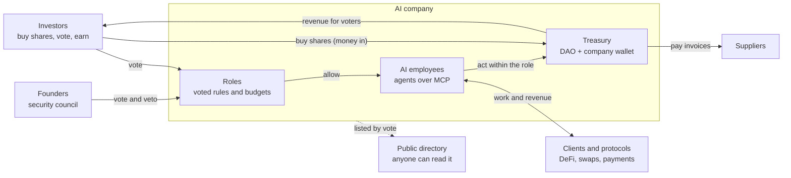
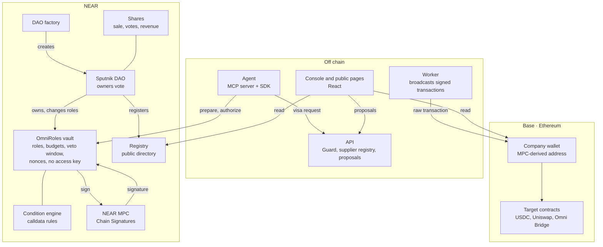

# MandateOS

**Create your AI company.** Agents do the work. Founders and investors own
the company and vote on the rules. A contract on NEAR enforces them: an agent
cannot sign anything its role does not allow, even when it is hacked.

Built for the [NEAR Hackathon](https://nearhackathon.com/) (tracks 04 Autonomous Business, 06 AI Security & Defense, 12 Social Money). Testnet only, unaudited.

## What it is

| | |
| --- | --- |
| **The company** | a Sputnik DAO on NEAR, and an **OmniRoles vault** with no access key that the DAO owns |
| **Its wallet** | one EVM address, the same on every EVM chain, derived by NEAR Chain Signatures (MPC) from the vault. Only the vault can ask for its signatures |
| **The AI employees** | agents with a NEAR key that can only ask the vault for operations, and a **role**: which chains, contracts, functions, parameters and budget |
| **The owners** | founders (members, two thirds, also the security council) and, optionally, **investors** who buy shares and vote with them |
| **The revenue** | goes to the investors who vote, epoch by epoch |

An agent never holds a key that moves funds. What its role allows is signed;
everything else is refused, and there is no escalation. Only the owners change
a role, by vote, and every change waits out a veto window.

## Product architecture



1. **Raise**: founders create the company; investors buy shares and the proceeds go to the treasury.
2. **Hire**: the owners vote a role for each AI employee. The agent plugs in over MCP.
3. **Work**: agents pay suppliers, swap and invest within their budget, and bring revenue back.
4. **Share**: each epoch, revenue goes to the investors who voted.
5. **Show**: the company lists itself in the public directory, by vote.

## Technical architecture



| Layer | Holds keys that move funds? |
| --- | --- |
| Agent | no: a NEAR key limited to `prepare`, `authorize`, `cancel_nonce`, `renounce_role` |
| API, Guard, worker | no: visa keys and broadcasting only |
| OmniRoles vault, registry, DAO factory | no access key after deployment |
| Company wallet | no private key exists; NEAR MPC signs only what the vault asks |

Contract invariants and the full key model: [Architecture.md](./Architecture.md).

## How an agent's payment goes through


The vault checks the role before any visa exists, so a stolen Guard key still
cannot leave the role. Without the Guard, agents stop, but founders can still
vote transactions.

## Owners and money

- **Founders** vote on everything by two thirds: roles, budgets, members, pause,
  and transactions outside any role (a multisig, also usable from any dApp via WalletConnect).
- **Investors** buy shares at a fixed price (proceeds go to the DAO) and lock
  them to vote on company calls and transfers, by majority of locked shares.
  Founders keep their veto on vault changes.
- **Revenue for voters**: what the company shares in an epoch (NEAR, or Base ETH
  bridged by Omni Bridge) goes to the holders who voted on at least one proposal
  of that epoch, pro rata. The part of the others goes to them.
- **An agent can share revenue on its own**: its role lets it send ETH through the
  Omni Bridge to the company's shares contract, and nowhere else.

Details: [docs/shares.md](./docs/shares.md).

## Proof

| What | Where |
| --- | --- |
| 45 attacks refused (hacked agent, stolen Guard key, stolen server, one rogue member) | `pnpm attack:all`, [docs/attacks.md](./docs/attacks.md) |
| The same attacks against a live testnet vault, read-only | `pnpm attack:testnet` |
| Shares: sale, votes, revenue only for voters, over three epochs | [docs/shares.md](./docs/shares.md) (testnet hashes) |
| An agent sends ETH from Base to the investors through Omni Bridge; the same call to another account is refused | [docs/shares.md](./docs/shares.md) (testnet hashes) |
| Keyless registry deployed; companies listed by DAO vote | [docs/registry.md](./docs/registry.md) (testnet hashes) |

## Run it

Requirements: Node 22, pnpm 12.15 (`npm i -g pnpm@12.15.0`), PostgreSQL, and
Rust with `cargo-near` for the contracts.

```bash
pnpm install
cp env.example .env            # fill it; never commit it
pnpm --filter @mandateos/db exec prisma db push
pnpm --filter @mandateos/api dev        # API on :3000
pnpm --filter @mandateos/api worker     # broadcasts what the vault signed
pnpm --filter @mandateos/console dev    # console on :5173
```

Checks:

```bash
pnpm typecheck && pnpm test
cd contracts && ./build.sh && cargo test --workspace
pnpm attack:all
```

## Repository

| Path | What |
| --- | --- |
| `contracts/vault` | the OmniRoles vault: roles, budgets, veto window, nonces, MPC signing |
| `contracts/omniroles-conditions` | the rule engine (condition trees on calldata, in Rust) |
| `contracts/shares` | shares: token, sale, Sputnik votes, revenue by epoch for voters |
| `contracts/dao-factory` | creates the company DAOs |
| `contracts/registry` | the public directory of companies |
| `contracts/tests` | sandbox tests and the on-chain attack suite |
| `apps/api` | sign-in, Guard, supplier registry, proposals, worker |
| `apps/console` | the console and the public pages (`/`, `/c/<dao>`) |
| `packages/sdk`, `packages/mcp` | the agent side: SDK and MCP server |
| `apps/demo-agent` | a small agent that pays invoices |

## Limits

- Built today: NEAR, Base and Ethereum; roles for paying suppliers, sharing revenue and Uniswap swaps. Solana, Bitcoin, a bank account, stocks, security audits and influence campaigns are shown on the landing but not built ([docs/explore.md](./docs/explore.md)).

- Testnet only. The contracts are unaudited.
- The Guard runs on the MandateOS server; its invoice screening is a filter, not a proof.
- NEAR MPC and Sputnik DAO are trusted as deployed.
- An investor majority outvotes the others on calls and transfers; the founders' veto on vault changes is the safeguard.
- Signing in proves a NEAR account, not a distinct human.
