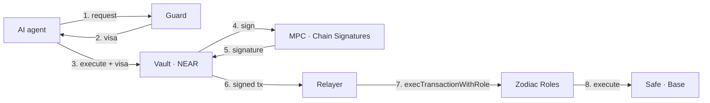

# MandateOS

**Let AI agents manage company funds, inside limits humans set and no key can bypass.**

MandateOS gives each AI agent a **mandate**: what it may do with the treasury, with which assets, how much, and where funds may go. The agent acts on its own within that mandate. It never holds a key, and every action passes three independent locks on two chains. Humans change the mandate only by vote.

> Built by [getjoin.io](https://getjoin.io)

---

## The problem

AI agents are ready to run treasury operations: paying suppliers, swapping into the right asset, moving funds across chains. Today the only way to let them is to hand them a wallet key, and then the agent's judgment is the only safeguard. A prompt injection, a poisoned document or a leaked secret is enough to drain the treasury.

Limits written inside the agent are not a defense, because the agent is what gets attacked. The limits have to live outside it, where it cannot touch them.

## The idea

| | Without MandateOS | With MandateOS |
|---|---|---|
| The agent holds | a private key | an identity that can only *ask* |
| Limits live | in the agent's prompt or code | in contracts and a policy the agent cannot modify |
| Who changes the limits | whoever controls the agent | the treasury members, by vote |
| Worst case if the agent is compromised | the whole wallet | the remaining budget of its role |

## What a mandate contains

A mandate is a **role**, written once in the console and enforced in three places:

```yaml
role: treasury-bot
operations:
  pay:
    to: registry            # only registered suppliers
    max_per_tx: 5000 USDC
  swap:
    sell: [USDC]
    buy: [WETH, NEAR]
    min_out: reference      # never below the reference price minus tolerance
    max_per_month: 20000 USDC
  bridge:
    to: own_wallets         # only the company's registered wallets, on any chain
    max_per_month: 10000 USDC
budget:
  period: monthly
  total: 30000 USDC
```

The same role compiles into the Guard policy, the NEAR vault configuration and the Zodiac Roles permissions on a Safe.

## The three locks

Every action the agent requests must pass all three. Each one can refuse on its own.

| Lock | Where | What it enforces |
|---|---|---|
| **1. Guard** | MandateOS backend | The business rules: known supplier and contract, reference never consumed, swap price against a reference, bridge destination in the company's wallet registry. Signs a short-lived visa bound to the exact transaction. |
| **2. Vault** | NEAR contract, one per client, no keys | Visa signature, nonce and expiry; role budget; allowlists; idempotence. Builds the transaction itself and asks NEAR Chain Signatures (MPC) to sign it. |
| **3. Zodiac Roles** | Safe | Target contracts, functions, parameters, periodic allowances. |



The agent's Base address (`0xAAA`) is derived from the vault account and the agent's path. Only the vault's code can make the MPC sign for it. Stealing the agent's credentials gives an attacker the right to *ask*, nothing more.

## Operations

| Operation | Path | Funds can only end up |
|---|---|---|
| **Pay** | Safe → `USDC.transfer` on Base | at a supplier in the registry |
| **Swap** | Safe → Cowswap Intents → solvers | back in the company's account, at or above the reference price |
| **Bridge** | NEAR Intents → `ft_withdraw` | in a wallet registered for the company |


Anything outside the mandate is not refused silently: Guard **escalates** it to the members, who approve or reject in the console.

## Governance

- **Members** vote onchain with **passkey accounts**: WebAuthn signatures verified on-chain (`p256_verify`), limited to voting.
- Every change to a mandate — role, budget, allowlist.
- A relay contract turns an approved proposal into an MPC signature from `0xGOV`, the owner of the Safe on Base. One vote on NEAR updates both chains(https://docs.near.org/tutorials/multichain-dao/introduction), with our own implementation.
- The console logs users in with a passkey (Better Auth). It **prepares** proposals, it never signs them.

## Non-custodial by design

- MandateOS cannot move funds on its own. The Guard key can only refuse, or approve within rules the members voted.
- If Guard is compromised, the vault and Zodiac still apply; the loss is bounded by the role budgets.
- The vault and relay have no access keys. Contracts are deployed by vote, from reproducible builds.
- Agent keys are generated on the client side; agents run at the client.

## Threat model (summary)

| Attack | Stopped by |
|---|---|
| Prompt injection asks the agent to send funds to an attacker | Guard: destination not in the registry → no visa |
| Swap at a manipulated price | Guard + vault: output below the reference price → refused |
| Bridge to an attacker wallet | Vault: destination not a registered company wallet |
| Fake invoice with a changed bank address | Guard: mismatch with the supplier record → escalation |
| Same operation executed twice | Guard + vault: reference already consumed |
| Agent calls the vault without a visa, or replays an old one | Vault: revert |
| Guard key stolen | Vault budgets + Zodiac allowances still apply |
| Vault bug | Zodiac allowlist and allowances on Base |

## Repository layout

```
contracts/          Rust (cargo-near)
  vault/            mandates, budgets, visa check, tx builder, MPC calls
  relay/            governance relay: Trezu proposal → 0xGOV signature
  passkey-account/  vote-only WebAuthn accounts
  signing/          shared EVM / ERC-191 encoding and MPC pipeline
apps/
  api/              Hono + Prisma + Postgres + Better Auth: Guard, relayer, watcher
  console/          React console: mandates, registries, escalations, proposals
packages/
  sdk/              TypeScript client for agents
  mcp/              MCP server exposing pay / swap / bridge to agents
  cli/              mandateos CLI
```

## Getting started

```bash
pnpm install
cp apps/api/.env.example apps/api/.env   # NEAR + Base RPC, Guard key, Intents API key
pnpm db:migrate

# contracts
cd contracts && cargo near build reproducible-wasm
cargo test                                # near-workspaces sandbox tests

# run
pnpm dev                                  # api + console
```


## License

MIT
