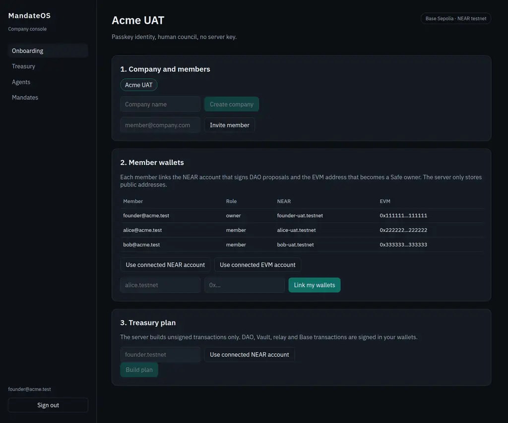
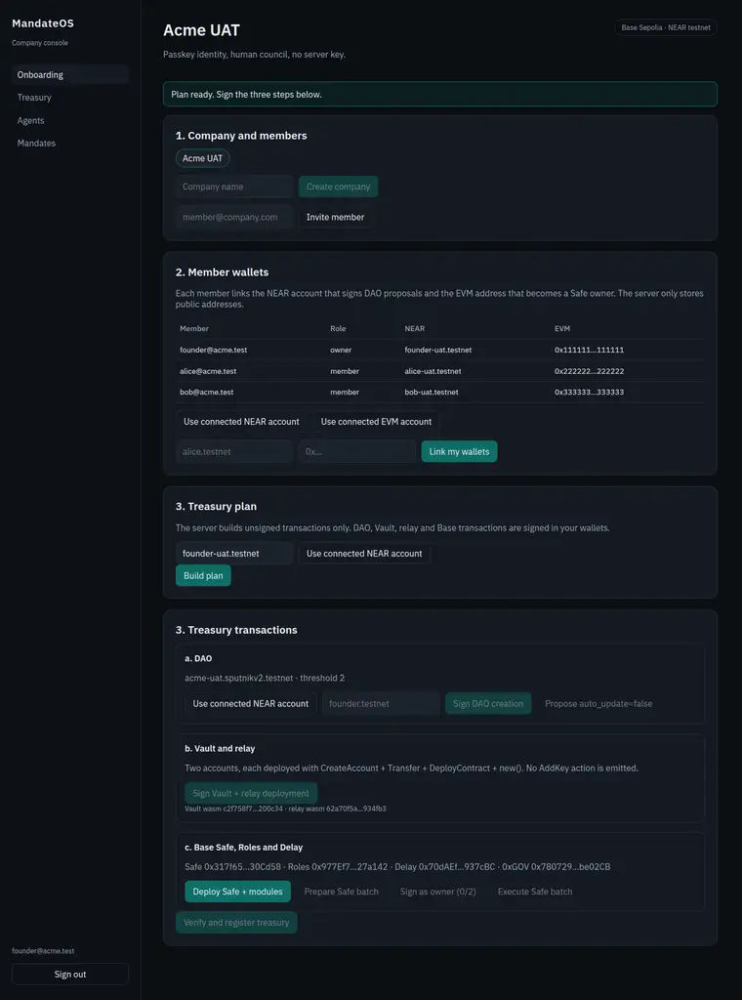
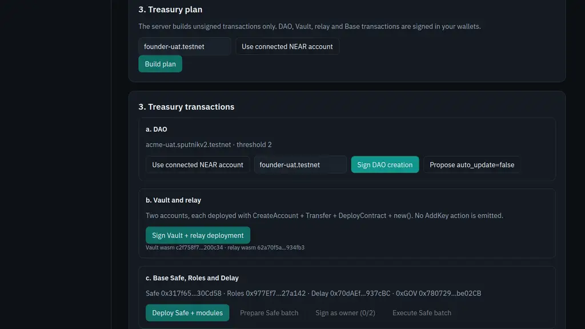
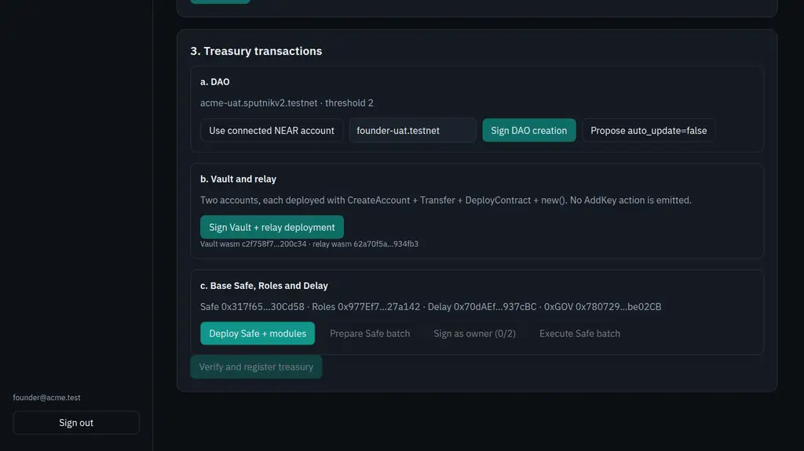

# UAT console — onboarding run

Date: 2026-10-21 · Base `9c906cd` plus the working tree under test.
Environment: NEAR testnet + Base Sepolia, real RPC (`v1.signer-prod.testnet`,
`https://sepolia.base.org`), local PostgreSQL.

This run exercises the console onboarding path. It stopped at the first
client-side signature because the headless test browser has no NEAR wallet and no
injected EVM wallet. No new on-chain transaction was produced by this run; the
blockers and the exact plan that would have been signed are recorded below.

## Steps reached

| # | Step | Result |
|---|---|---|
| 1 | Founder account + organization `Acme UAT` | OK |
| 2 | 2 members invited, invitations accepted, NEAR + EVM wallets linked | OK |
| 3 | Treasury plan built by the server | OK |
| 4 | DAO creation signature | **Blocked: no NEAR wallet** |
| 5 | Vault + relay deployment signature | Not reached |
| 6 | Safe/Roles/Delay deployment + 2/3 Safe batch | Not reached |
| 7 | `FactoryInfoUpdate` vote + refresh | Not reached |
| 8 | Agent `compta-bot` + mandate + votes + Delay cooldown | Not reached |
| 9 | 1 TestUSDC payment + agent on-chain state | Not reached |

### 1–2. Organization and members



- `founder@acme.test` (`owner`) ↔ `founder-uat.testnet` /
  `0x1111111111111111111111111111111111111111`
- `alice@acme.test` (`member`) ↔ `alice-uat.testnet` /
  `0x2222222222222222222222222222222222222222`
- `bob@acme.test` (`member`) ↔ `bob-uat.testnet` /
  `0x3333333333333333333333333333333333333333`

The console generated the invitation links. Because this environment has no
email delivery, the two invitations were accepted through the Better Auth API
with the members' own sessions; the console then displayed all three members and
their linked wallets.

### 3. Treasury plan



The plan was built against real testnet/Base RPC and returned:

| Component | Value |
|---|---|
| DAO | `acme-uat.sputnikv2.testnet` |
| Council threshold | `2` (ceil(2×3/3)) |
| Vault | `acme-uat-vault.founder-uat.testnet` |
| Relay | `acme-uat-relay.founder-uat.testnet` |
| 0xGOV | `0x780729296D3AF1087c94623a5A6CB4f111be02CB` |
| Safe | `0x317f657fCa5cC2DD11B594Bba8c1806eeE30Cd58` |
| Roles | `0x977Ef7e77445AfEE2a888485Abb38d730F27a142` |
| Delay | `0x70dAEffe8f861166EF256965A5f240fAd0937cBC` |
| Vault wasm SHA-256 | `c2f758f7be4f0ab13becdda21740068cb4b3be9f2c7d775ee56787fccd200c34` |
| Relay wasm SHA-256 | `62a70f5ab3b0d269dac14c7dc6be00cffe6af747110e06e4dc07efae61934fb3` |

Safe/Roles/Delay addresses are CREATE2 predictions from their salts; they are
only valid once the deployment transactions are mined.

## Funding update

A fresh testnet account was sponsored by the official helper (one request, no
faucet loop): `mandateos-uat-mvi3degx.testnet` received 10 NEAR, then 9 NEAR were
moved from `mandateos-root-20261021.testnet`, for 19 NEAR total. Plan deposits
were reduced from 10/10/10 to the measured UAT storage needs: DAO 7,5 NEAR,
Vault 5 NEAR, relay 5 NEAR (17,5 NEAR total), leaving a small gas buffer.

This is historical evidence for that UAT run. The current permissionless
`factory-v2.mandateos.testnet` uses the official immutable global Sputnik hash:
the sponsored founder wallet signs and attaches 0.25 NEAR; a complete new
treasury requires 8.75 NEAR for DAO + Vault + relay.

`0x1D693a4425bf7eD10FE7775E2b65b072019FFceb` was funded with 0.002 ETH on Base
Sepolia. Its private key is not in the harness; it can be a Safe owner signed
manually in MetaMask. The automated 2/3 batch uses the deployer key and council
key 1.

## Automated harness result (real testnet)

The injected-signer Playwright test passed (`E2E=1`, 32 s):

- DAO `e2e-mvi3tup7.sputnikv2.testnet` created from the console;
- balance `7.50 NEAR`, code hash `AA4nA45vauiac3jdVwJTzSdUP3oj2r1fDaPAb2mHdgcH`
  (the `sputnikv2.testnet` default);
- the transaction was signed by the injected NEAR signer
  (`mandateos-uat-mvi3degx.testnet`), not by the server.

The exact creation hash is not exposed by the testnet indexers used here; the
account and code hash are the on-chain evidence. Future runs attach the hash
printed by the console.

## Blockers

### B1 — no NEAR wallet in the test browser



Clicking **Sign DAO creation** returns:

```text
No wallet selected
```

The console uses `@near-wallet-selector` in browser mode. Headless Chromium has no
MyNearWallet extension and no mobile wallet connection. Unblocking requires a
funded NEAR testnet account and one of:

- a browser with MyNearWallet installed (or Wallet Selector's web wallet), or
- a client-side signer injected into the page for the UAT harness, with keys held
  outside the server.

Deposit required by the plan: `10 NEAR` for the factory `create` call. The founder
account must also pay for the Vault and relay `CreateAccount + Transfer +
DeployContract` actions (`10 NEAR` each in the plan).

### B2 — no injected EVM wallet



Clicking **Deploy Safe + modules** returns:

```text
No EVM wallet found
```

The Safe deployment and the 2/3 Safe batch are signed with `window.ethereum`
through viem. The test browser has no injected provider. Unblocking requires a
Base Sepolia-funded EVM wallet (one council owner) and a second owner to collect
the second Safe signature.

## Consequences

- No `FactoryInfoUpdate` proposal, no refresh-to-active, no agent, no mandate
  votes, and no TestUSDC payment were executed in this run.
- No new transaction hash can be reported. Existing on-chain evidence from the
  earlier UAT remains in [`deployments/base-sepolia.json`](../deployments/base-sepolia.json)
  and [`deployments/near-testnet.json`](../deployments/near-testnet.json)
  (1 TestUSDC payment `0x0bf66f0c…4ea4`, veto `0xab38cd09…e324`), but it does not
  cover the console onboarding flow.

## Reproduction

```bash
# PostgreSQL
export DATABASE_URL=postgresql://postgres@127.0.0.1:55432/mandateos_test
pnpm --filter @mandateos/db exec prisma db push

# API (real RPC)
export BETTER_AUTH_SECRET=... BETTER_AUTH_URL=http://localhost:3000 \
  CONSOLE_ORIGIN=http://localhost:5173 PASSKEY_RP_ID=localhost \
  NEAR_RELAYER_ACCOUNT_ID=... NEAR_RELAYER_PRIVATE_KEY=... \
  GUARD_ED25519_PRIVATE_KEY_BASE64=... \
  BUDGET_TOKEN_ACCOUNT_ID=test-ft-v4.mandateos-root-20261021.testnet
pnpm --filter @mandateos/api dev

# Console
pnpm --filter @mandateos/console dev
```

Then create the organization, invite two members, link wallets, and build the plan.
The next console run must provide the two wallets above.
